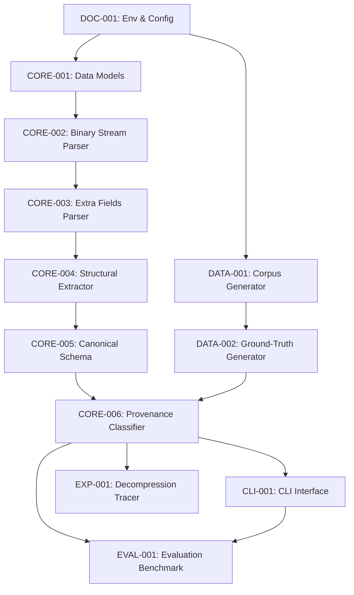

# Lộ trình Triển khai Dự án Tái hiện Nghiên cứu (Implementation Plan)

**Dự án:** File Fingerprinting of the ZIP Format for Identifying and Tracking Provenance  
**Mục tiêu:** Cung cấp lộ trình hành động có cấu trúc chặt chẽ, chia nhỏ thành các nhiệm vụ độc lập, có thể giao việc trực tiếp cho kỹ sư phần mềm hoặc AI coding agent thực thi.  

---

## 1. Định nghĩa Mức độ Ưu tiên (Priority Levels)
- **P0:** Nền tảng bắt buộc, quyết định tính khả thi của việc tái hiện.
- **P1:** Thành phần cốt lõi của Sản phẩm Khả dụng Tối thiểu (MVP) để kiểm chứng phương pháp bài báo.
- **P2:** Mở rộng thực nghiệm, nâng cao độ tin cậy và tự động hóa.
- **P3:** Nghiên cứu nâng cao và các tính năng bổ trợ kỹ thuật số sau tái hiện.

---

## 2. Danh mục Nhiệm vụ Chi tiết (Task Backlog)

### Giai đoạn 0 & 1: Xác minh Phương pháp và Thiết lập Dự án

#### `DOC-001`: Thiết lập Tài liệu Nghiên cứu và Cấu hình Môi trường Cơ sở
- **Mức độ ưu tiên:** P0
- **Phụ thuộc:** Không có
- **Mục tiêu:** Chuẩn bị đầy đủ tài liệu phương pháp, thiết lập cấu hình công cụ Python và môi trường phát triển chuẩn mực.
- **Nội dung công việc:**
  1. Khởi tạo `pyproject.toml` (quản lý metadata dự án, cấu hình `pytest`, `black`, `flake8`, `mypy`).
  2. Khởi tạo `.gitignore` (loại bỏ tệp tạm Python, thư mục dữ liệu lớn `.zip`, cache).
  3. Cập nhật `README.md` hướng dẫn thiết lập môi trường bằng Python 3.11.
- **Đầu vào:** Kết quả kiểm kê từ `source-audit.md`.
- **Tệp tạo/chỉnh sửa:** `pyproject.toml`, `.gitignore`, `README.md`.
- **Đầu ra:** Môi trường dự án chuẩn hóa, lệnh `pytest` thực thi thành công.
- **Tiêu chí nghiệm thu:** `git status` sạch, cấu hình cài đặt không bị lỗi cú pháp, có thể chạy môi trường ảo chuẩn.
- **Rủi ro:** Chưa có.

---

### Giai đoạn 2: Thiết kế Dữ liệu và Pipeline Tạo Mẫu Thử nghiệm

#### `DATA-001`: Xây dựng Bộ Sinh Thư mục Tiêu chuẩn (Corpus Generator)
- **Mức độ ưu tiên:** P0
- **Phụ thuộc:** `DOC-001`
- **Mục tiêu:** Tạo cấu trúc tệp/thư mục chuẩn có kiểm soát để phục vụ nén mẫu thực nghiệm.
- **Nội dung công việc:**
  1. Viết script `scripts/prepare_corpus.py` tạo cây thư mục mẫu cố định.
  2. Bổ sung các tệp văn bản ASCII, tệp nhị phân giả lập, thư mục rỗng và tệp Unicode đa ngôn ngữ (tiếng Hàn UTF-8 NFD/NFC, tiếng Việt).
  3. Cố định dấu thời gian hệ thống tệp cho các tệp mẫu (`2024-01-01 12:00:00 UTC`).
- **Đầu vào:** `docs/research/experimental-design.md`.
- **Tệp tạo/chỉnh sửa:** `scripts/prepare_corpus.py`, `data/templates/`.
- **Đầu ra:** Cấu trúc mẫu chuẩn có thể sinh lại nhất quán bất cứ lúc nào.
- **Tiêu chí nghiệm thu:** Chạy script tạo ra cây thư mục với đúng checksum và timestamp định trước.
- **Rủi ro:** Một số hệ thống tệp làm tròn mốc thời gian không đều.

#### `DATA-002`: Xây dựng Kịch bản Tự động Sinh Mẫu Nén (Ground-Truth Generator)
- **Mức độ ưu tiên:** P1
- **Phụ thuộc:** `DATA-001`
- **Mục tiêu:** Gọi các công cụ nén trên máy trạm (Windows Built-in, 7-Zip, WinRAR, Bandizip) để tạo bộ dữ liệu mẫu có nhãn.
- **Nội dung công việc:**
  1. Viết script `scripts/generate_ground_truth.py` tự động phát hiện các công cụ nén đã cài trên máy.
  2. Thực thi nén cây thư mục tiêu chuẩn với từng công cụ ở cấu hình mặc định.
  3. Ghi lại metadata nguồn gốc vào `data/ground_truth/metadata.json` (tên công cụ, phiên bản, câu lệnh thực thi, SHA-256).
- **Đầu vào:** `scripts/prepare_corpus.py`.
- **Tệp tạo/chỉnh sửa:** `scripts/generate_ground_truth.py`, `data/ground_truth/metadata.json`.
- **Đầu ra:** Tối thiểu 4 mẫu ZIP từ 4 phần mềm nén trên Windows.
- **Tiêu chí nghiệm thu:** Mỗi tệp ZIP sinh ra đều có bản ghi metadata tương ứng với checksum SHA-256 chính xác.
- **Rủi ro:** Máy trạm thiếu một số phần mềm (cần hỗ trợ chế độ graceful skip hoặc mock đối chứng).

---

### Giai đoạn 3: Xây dựng Bộ Phân tích Cấu trúc Nhị phân ZIP (Raw Binary Parser)

#### `CORE-001`: Triển khai Cấu trúc Dữ liệu và Mô hình Định dạng ZIP (Data Models)
- **Mức độ ưu tiên:** P0
- **Phụ thuộc:** `DOC-001`
- **Mục tiêu:** Định nghĩa các dataclass biểu diễn cấu trúc nhị phân của tệp ZIP tuân thủ PKWARE APPNOTE.
- **Nội dung công việc:**
  1. Định nghĩa `LocalFileHeader`, `CentralDirectoryHeader`, `EndOfCentralDirectory`, `Zip64EndOfCentralDirectory`.
  2. Định nghĩa cấu trúc `ExtraFieldRecord` gồm `header_id`, `data_size`, `raw_data`.
  3. Xây dựng các hằng số chuẩn (Magic Signatures, Host OS byte codes, Common Header IDs).
- **Đầu vào:** APPNOTE.TXT, `docs/research/paper-mapping.md`.
- **Tệp tạo/chỉnh sửa:** `src/zip_fingerprint/models.py`, `src/zip_fingerprint/constants.py`.
- **Đầu ra:** Các lớp dữ liệu có kiểu rõ ràng (type-annotated dataclasses).
- **Tiêu chí nghiệm thu:** Có type hinting đầy đủ, đạt kiểm tra `mypy`.
- **Rủi ro:** Không có.

#### `CORE-002`: Xây dựng Trình Phân tích Nhị phân Cốt lõi (Binary Stream Parser)
- **Mức độ ưu tiên:** P0
- **Phụ thuộc:** `CORE-001`
- **Mục tiêu:** Đọc và giải mã an toàn các cấu trúc EOCD, CDH, LFH từ tệp nhị phân mà không nén/giải nén payload.
- **Nội dung công việc:**
  1. Viết `src/zip_fingerprint/parser.py` mở tệp nhị phân ở chế độ `rb`.
  2. Tìm kiếm EOCD từ cuối tệp (quét ngược 64KB cuối để tìm chữ ký `0x06054b50`).
  3. Đọc tuần tự toàn bộ danh sách Central Directory Headers.
  4. Đọc tương ứng các Local File Headers dựa trên relative offset.
  5. Xử lý ngoại lệ an toàn cho tệp hỏng (`CorruptZipError`).
- **Đầu vào:** `models.py`, `constants.py`.
- **Tệp tạo/chỉnh sửa:** `src/zip_fingerprint/parser.py`, `src/zip_fingerprint/exceptions.py`.
- **Đầu ra:** Lớp `ZipBinaryParser` trả về `ZipArchiveRecord`.
- **Tiêu chí nghiệm thu:** Phân tích thành công 100% các tệp trong bộ mẫu chuẩn; ném ngoại lệ đúng khi đọc tệp rác.
- **Rủi ro:** Các tệp có comment dài ở EOCD cần logic quét ngược chuẩn xác.

#### `CORE-003`: Giải mã Chuyên sâu Trường Mở rộng (Extra Fields Parser)
- **Mức độ ưu tiên:** P1
- **Phụ thuộc:** `CORE-002`
- **Mục tiêu:** Phân rã chuỗi nhị phân Extra Field thành các cấu trúc ý nghĩa số học và pháp y.
- **Nội dung công việc:**
  1. Viết hàm giải mã cho `0x5455` (Extended Timestamp: trích xuất mtime, atime, ctime Unix 32-bit).
  2. Giải mã `0x7875` (Info-ZIP New Unix: trích xuất UID, GID).
  3. Giải mã `0x7075` (Unicode Path: trích xuất CRC-32 và chuỗi Unicode UTF-8).
  4. Giải mã `0x000a` (NTFS Extra Field: trích xuất 100ns FileTimes M/A/C).
  5. Bảo toàn thứ tự xuất hiện gốc của các khối Header ID.
- **Đầu vào:** `src/zip_fingerprint/parser.py`.
- **Tệp tạo/chỉnh sửa:** `src/zip_fingerprint/extra_fields.py`.
- **Đầu ra:** Các đối tượng giải mã chi tiết của từng loại Extra Field.
- **Tiêu chí nghiệm thu:** Đọc chính xác các timestamp 100ns của NTFS và Unix timestamp từ dữ liệu kiểm thử nhân tạo.
- **Rủi ro:** Các trường mở rộng bị cắt cụt do phần mềm tạo lỗi.

---

### Giai đoạn 4: Trích xuất Đặc trưng và Lược đồ Fingerprint

#### `CORE-004`: Triển khai Bộ Trích xuất Vector Cấu trúc (Structural Extractor)
- **Mức độ ưu tiên:** P1
- **Phụ thuộc:** `CORE-003`
- **Mục tiêu:** Tổng hợp toàn bộ các đặc trưng cấu trúc được bài báo xác định thành một vector thống nhất.
- **Nội dung công việc:**
  1. Trích xuất `host_os` từ byte cao `version_made_by` của CDH.
  2. Kiểm tra vị trí Extra Field: Chỉ có trong CDH, hay có cả trong LFH.
  3. Xác định thứ tự các Header ID (`extra_field_sequence`).
  4. Kiểm tra sự hiện diện của chữ ký Data Descriptor (`0x08074b50`) và cờ Bit 3.
  5. Kiểm tra dạng chuẩn hóa Unicode tên tệp (NFD vs NFC) thông qua module `unicodedata`.
  6. Tính toán chênh lệch múi giờ giữa DOS time và UTC Extended/NTFS time.
  7. Phân tích thứ tự duyệt entry và việc ghi nhận thư mục rỗng.
- **Đầu vào:** `ZipArchiveRecord`, `extra_fields.py`.
- **Tệp tạo/chỉnh sửa:** `src/zip_fingerprint/extractor.py`.
- **Đầu ra:** Đối tượng `StructuralFingerprint`.
- **Tiêu chí nghiệm thu:** Trích xuất đầy đủ và chính xác toàn bộ các trường theo mô tả trong `docs/research/paper-mapping.md`.
- **Rủi ro:** Tệp không chứa ký tự tiếng Hàn/tiếng Việt thì không xác định được NFD/NFC (cần gán nhãn `INDETERMINATE`).

#### `CORE-005`: Lược đồ Dấu vân tay Tuần hoàn và Băm Cấu trúc (Canonical Fingerprint Schema)
- **Mức độ ưu tiên:** P1
- **Phụ thuộc:** `CORE-004`
- **Mục tiêu:** Định nghĩa lược đồ JSON có phiên bản (versioned schema) và sinh mã băm cấu trúc xác định.
- **Nội dung công việc:**
  1. Xây dựng lược đồ JSON `zip_fingerprint_v1.0`.
  2. Chuẩn hóa việc tuần tự hóa JSON (sắp xếp khóa `sort_keys=True`, mã hóa UTF-8, không có khoảng trắng thừa).
  3. Tính toán mã băm cấu trúc `structural_hash` bằng SHA-256 từ chuỗi JSON chuẩn hóa của vector đặc trưng.
- **Đầu vào:** `StructuralFingerprint`.
- **Tệp tạo/chỉnh sửa:** `src/zip_fingerprint/schema.py`, `src/zip_fingerprint/hasher.py`.
- **Đầu ra:** Tệp/chuỗi JSON fingerprint và mã băm cấu trúc 64 ký tự hex.
- **Tiêu chí nghiệm thu:** Hai lần sinh trên cùng một file cho chuỗi SHA-256 giống hệt nhau 100%.
- **Rủi ro:** Không có.

---

### Giai đoạn 5: Động cơ Nhận diện Nguồn gốc và Truy vết Giải nén

#### `CORE-006`: Xây dựng Động cơ Phân loại Luật Nguồn gốc (Provenance Classifier)
- **Mức độ ưu tiên:** P1
- **Phụ thuộc:** `CORE-005`
- **Mục tiêu:** Tái hiện bộ phân loại tự động của bài báo nhằm xác định HĐH và công cụ nén.
- **Nội dung công việc:**
  1. Lập bảng luật dựa trên các đặc trưng đã xác minh từ bài báo và báo cáo Interpol.
  2. Triển khai cây quyết định kết hợp điểm tin cậy (Confidence Scoring):
     - Luật HĐH: Host OS + NFD/NFC + UID/GID / NTFS.
     - Luật Phần mềm: Vị trí Extra Field + Sequence + Data Descriptor + Cấu trúc thư mục.
  3. Trả về kết quả phân loại: `CandidateEnvironment(os, application, confidence, matched_rules, warnings)`.
- **Đầu vào:** `StructuralFingerprint`.
- **Tệp tạo/chỉnh sửa:** `src/zip_fingerprint/classifier.py`, `src/zip_fingerprint/rules.py`.
- **Đầu ra:** Kết quả phân loại nguồn gốc kèm luận cứ bằng chứng.
- **Tiêu chí nghiệm thu:** Phân loại đúng 100% các mẫu trong bộ Ground-truth của Windows 11 và Ubuntu.
- **Rủi ro:** Xung đột luật nếu hai công cụ có đặc trưng tương đồng (cần xếp hạng theo độ ưu tiên đặc trưng).

#### `EXP-001`: Thí nghiệm Truy vết Hành vi Dấu thời gian Giải nén (Decompression Tracer)
- **Mức độ ưu tiên:** P2
- **Phụ thuộc:** `CORE-006`
- **Mục tiêu:** Khảo sát sự thay đổi của thời gian MACB khi giải nén bằng các công cụ khác nhau.
- **Nội dung công việc:**
  1. Viết script `experiments/trace_decompression.py`.
  2. Tự động giải nén tệp mẫu bằng Windows Explorer, 7-Zip, WinRAR, Bandizip vào thư mục tạm sạch.
  3. Ghi lại các mốc Created Time, Last Write Time, Last Access Time của tệp và thư mục con bằng Windows API.
  4. Lập bảng ma trận so sánh hành vi giữa các công cụ.
- **Đầu vào:** Mẫu ZIP chuẩn từ `data/ground_truth/`.
- **Tệp tạo/chỉnh sửa:** `experiments/trace_decompression.py`, `results/decompression_profiles.json`.
- **Đầu ra:** Báo cáo hồ sơ hành vi giải nén.
- **Tiêu chí nghiệm thu:** Ghi nhận được sự khác biệt có ý nghĩa thống kê giữa ít nhất 3 công cụ trên Windows.
- **Rủi ro:** Quyền truy cập tệp hoặc độ trễ hệ thống tệp NTFS có thể gây dao động nhỏ ở Last Access Time.

---

### Giai đoạn 6: Giao diện Dòng lệnh (CLI) và Báo cáo Đánh giá

#### `CLI-001`: Triển khai Giao diện Dòng lệnh Độc lập
- **Mức độ ưu tiên:** P1
- **Phụ thuộc:** `CORE-006`
- **Mục tiêu:** Cung cấp công cụ CLI thuận tiện cho giám định viên điều tra số.
- **Nội dung công việc:**
  1. Viết `src/zip_fingerprint/cli.py` sử dụng `argparse`.
  2. Hỗ trợ các lệnh:
     - `fingerprint <zip_path>`: Xuất JSON fingerprint cấu trúc và mã băm.
     - `identify <zip_path>`: Phân tích và in kết quả nhận diện nguồn gốc môi trường (HĐH, phần mềm, độ tin cậy).
     - `compare <zip1> <zip2>`: So sánh tương đồng giữa hai kho lưu trữ.
  3. Định dạng đầu ra đẹp mắt, hỗ trợ cả xuất ra bảng text hoặc xuất ra tệp JSON.
- **Đầu vào:** `extractor.py`, `classifier.py`.
- **Tệp tạo/chỉnh sửa:** `src/zip_fingerprint/cli.py`, `src/zip_fingerprint/__main__.py`.
- **Đầu ra:** Công cụ CLI gọi được qua lệnh `python -m zip_fingerprint`.
- **Tiêu chí nghiệm thu:** Các lệnh CLI chạy mượt mà, trả về mã lỗi `0` khi thành công, in trợ giúp rõ ràng với `--help`.
- **Rủi ro:** Không có.

#### `EVAL-001`: Đánh giá Định lượng và Báo cáo Tái hiện Khoa học
- **Mức độ ưu tiên:** P1
- **Phụ thuộc:** `CORE-006`, `CLI-001`
- **Mục tiêu:** Tổng hợp kết quả thực nghiệm và lập báo cáo khoa học đối chiếu.
- **Nội dung công việc:**
  1. Viết kịch bản `experiments/evaluate_benchmark.py` chạy trên toàn bộ tập mẫu kiểm nghiệm mù.
  2. Tính toán ma trận nhầm lẫn (Confusion Matrix), Accuracy, Precision, Recall cho từng phần mềm nén.
  3. Lập báo cáo kết quả `docs/evaluation/reproduction_report.md` đối chiếu trực tiếp với bài báo gốc.
- **Đầu vào:** Tập mẫu kiểm nghiệm và bộ phân loại.
- **Tệp tạo/chỉnh sửa:** `experiments/evaluate_benchmark.py`, `docs/evaluation/reproduction_report.md`.
- **Đầu ra:** Báo cáo khoa học hoàn chỉnh về khả năng tái hiện.
- **Tiêu chí nghiệm thu:** Báo cáo minh bạch toàn bộ tỷ lệ chính xác đo được, phân tích rõ ràng mọi trường hợp ngoại lệ.
- **Rủi ro:** Cần kiểm tra kỹ các trường hợp nhầm lẫn giữa các phiên bản phần mềm.

---

## 3. Sơ đồ Phụ thuộc và Đường dẫn Tới hạn (Critical Path)

*Đường dẫn tới hạn (Critical Path):*  
`DOC-001` → `CORE-001` → `CORE-002` → `CORE-003` → `CORE-004` → `CORE-005` → `CORE-006` → `EVAL-001`.
