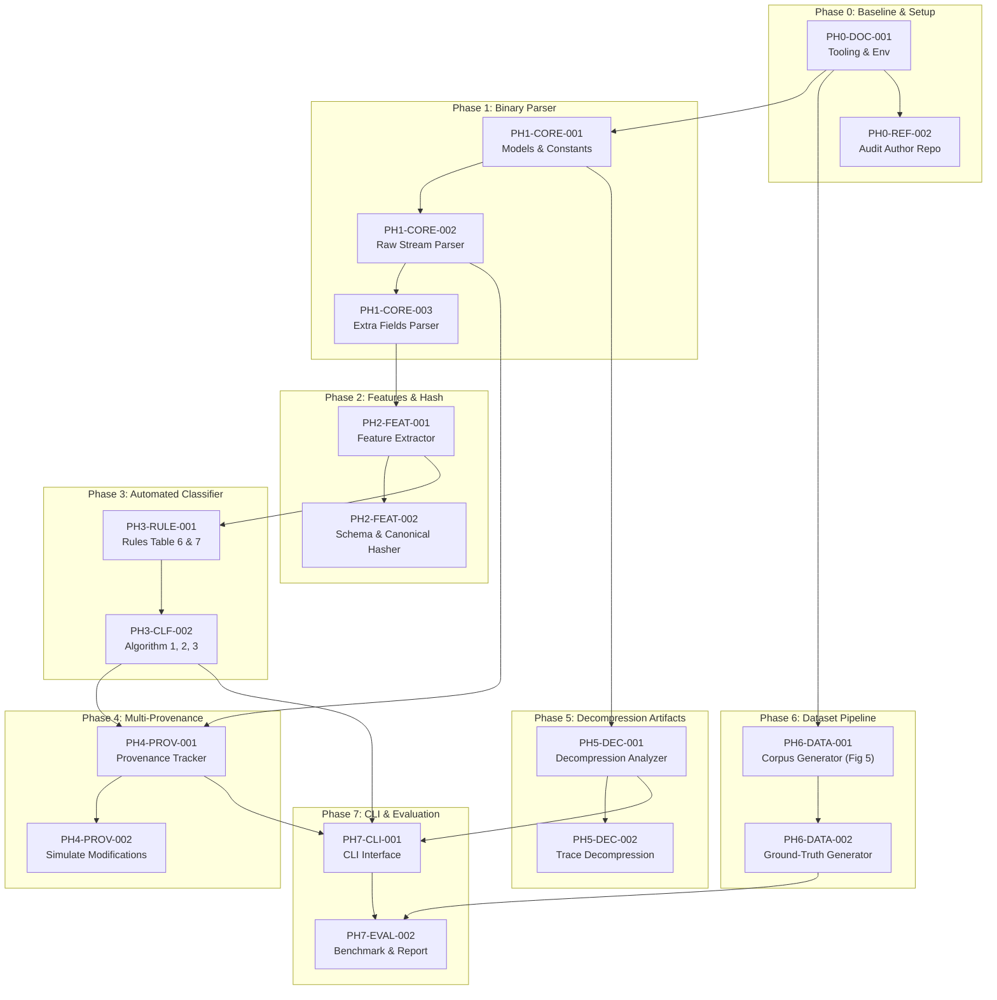

# Lộ trình Triển khai Chi tiết Tái hiện Nghiên cứu (Implementation Plan)

**Dự án:** File Fingerprinting of the ZIP Format for Identifying and Tracking Provenance  
**Bài báo nghiên cứu chính thức:** Minji Um, Jaehyeok Han, Sangjin Lee. *Forensic Science International: Digital Investigation*, 39, 2021, 301271.  
**DOI:** `10.1016/j.fsidi.2021.301271` | **Kho tham khảo tác giả:** `https://github.com/um2inji/PKZIP`  
**Ngày cập nhật:** 25/10/2026 (Đồng bộ hóa toàn diện sau khi tiếp nhận bản PDF toàn văn 10 trang của bài báo).

---

## 1. Đánh giá Tính Phù hợp và Độ Bám sát của Kế hoạch (Plan Audit & Gap Analysis)

Sau khi đọc và thẩm định chi tiết bản toàn văn PDF chính thức của bài báo, kế hoạch triển khai đã được rà soát đối chiếu. Dưới đây là đánh giá cụ thể:

### 1.1 Những điểm kế hoạch ban đầu đã phù hợp và bám sát
- **Định hướng kiến trúc:** Quyết định xây dựng bộ phân tích luồng nhị phân nguyên thủy (`ZipBinaryParser`) từ đầu thay vì dựa vào module `zipfile` của Python là hoàn toàn chính xác, vì bài báo đòi hỏi phân tích cấu trúc nhị phân cấp thấp của Extra Fields và thứ tự các trường.
- **Trọng tâm định dạng:** Xác định đúng các trường mở rộng quan trọng (`0x000A`, `0x5455`, `0x7875`, `0x7075`), chuẩn hóa Unicode (NFD trên macOS vs NFC trên Windows/Ubuntu), và nguyên lý tính múi giờ từ độ lệch DOS time và UTC timestamp.
- **Phạm vi hệ điều hành:** Bao phủ đầy đủ 3 môi trường chính: Windows, macOS và Ubuntu Linux.

### 1.2 Những điểm thiếu sót và điều chỉnh quan trọng từ bản PDF chính thức
Từ bản PDF chính thức, kế hoạch triển khai đã được nâng cấp và bổ sung 7 nội dung cốt lõi:
1. **Kho mã nguồn chính thức của tác giả:** Bài báo công bố rõ repo tham khảo tại Footnote 1 (`https://github.com/um2inji/PKZIP`), giúp loại bỏ giả định "chưa có mã nguồn gốc" và cung cấp đối tượng tham chiếu trực tiếp.
2. **Cấu trúc bộ phân loại 2 tầng với 3 thuật toán cụ thể (Hình 7 & 8):**
   - **Tầng trọng số cao (High-weight):** Gồm `Algorithm 1` (định danh phần mềm SW dựa trên Data descriptor và kiểu/độ dài Extra fields) và `Algorithm 2` (định danh HĐH OS dựa trên `version_made_by`: 0x00 Windows, 0x03 Unix/macOS/Ubuntu).
   - **Tầng phụ trợ (Subsidiary low-weight):** `Algorithm 3` (giải quyết xung đột khi tầng 1 không xác định được duy nhất: kiểm tra Double zipping, thư mục `__MACOSX`, mẫu nanosecond `fff0000`/`fffffff`/`0000000`, NFC/NFD, CP949 vs UTF-8, UID/GID, v.v.).
3. **Bổ sung Extra Field `0x5855` và quy tắc độ dài `0x5455`:**
   - Trường `0x5855` (Unix Extra Field) được Bandizip dùng riêng trên macOS (Bảng 4).
   - Chiều dài trường `0x5455` là đặc trưng phân biệt quan trọng: 13 bytes (m/a/c) cho cả Local và Central khi dùng `Compress` trên macOS/Ubuntu; nhưng lại là 9 bytes (Local) và 5 bytes (Central) khi dùng lệnh `zip` dòng lệnh (Bảng 7).
4. **Đặc trưng độ phân giải Nanosecond của WinZip:**
   - WinZip trên Windows có đặc trưng độc nhất: 4 ký tự hex cuối của nanosecond trong `0x000A` luôn bị xóa về 0 (`fff0000`), trong khi WinRAR, 7-zip và Bandizip lưu đầy đủ `fffffff` từ `$STANDARD_INFORMATION` (Bảng 6).
5. **Thứ tự Header ID trong Central Directory (Central Extra Field Sequence):**
   - WinRAR và Bandizip: `0x000A` đứng trước `0x7075`.
   - WinZip: `0x7075` đứng trước `0x000A`.
   - 7-Zip: chỉ lưu `0x000A`.
   - Windows Built-in: không lưu bất kỳ Extra Field nào (Bảng 6).
6. **Mở rộng phạm vi nghiên cứu: Thí nghiệm Can thiệp Tệp & Đa Nguồn gốc (Mục 4.2 & Hình 10):**
   - Bổ sung module `provenance.py` phân tích 2 kịch bản khi tệp ZIP bị thêm, xóa hoặc chỉnh sửa bằng một phần mềm khác (SW2):
     * **Case 1:** Chỉ entry bị thao tác mang vân tay của SW2 (hiện tượng vân tay hỗn hợp - Mixed Fingerprints trong cùng một archive).
     * **Case 2:** Thao tác xóa làm thay đổi/loại bỏ Extra fields trên toàn bộ các entry còn lại.
7. **Mở rộng phạm vi nghiên cứu: Dấu vết Thời gian Giải nén & Đảo ngược Thời gian (Mục 4.3 & Bảng 8):**
   - Bổ sung module `decompression.py` mã hóa toàn bộ ma trận BMAC (Birth, Modified, Accessed, Changed) của 5 công cụ giải nén trên Windows đối với File, Folder có file và Folder rỗng; đánh giá hiện tượng đảo ngược thời gian (Time reversal phenomenon).

---

## 2. Định nghĩa Cấp độ Ưu tiên (Priority Levels)
- **P0 (Critical Foundation):** Cốt lõi bắt buộc, quyết định nền tảng phân tích và khả năng tái hiện logic bài báo.
- **P1 (Core Reproduction):** Các module chức năng chính để tái hiện trọn vẹn kết quả phân loại, truy vết đa nguồn gốc và giao diện dòng lệnh.
- **P2 (Extended Validation):** Kịch bản thực nghiệm đo lường mở rộng trên hệ thống tệp và đánh giá định lượng chuyên sâu.

---

## 3. Danh mục Nhiệm vụ Chi tiết Từng Giai đoạn (Granular Task Backlog)

### Giai đoạn 0: Thiết lập Dự án, Công cụ và Chuẩn bị Baseline Khoa học

#### `PH0-DOC-001`: Chuẩn hóa Môi trường Phát triển và Cấu hình Tooling
- **Mức độ ưu tiên:** P0
- **Phụ thuộc:** Không có
- **Mục tiêu:** Đảm bảo dự án có môi trường Python chuẩn mực, cấu hình kiểm thử tự động, linter và type checker đồng nhất.
- **Nội dung công việc:**
  1. Hoàn thiện `pyproject.toml` khai báo gói `zip-fingerprint`, cấu hình `pytest`, `mypy`, `black`.
  2. Hoàn thiện `.gitignore` loại trừ file cache, môi trường ảo và dữ liệu nhị phân lớn.
  3. Kiểm tra môi trường Python 3.11 hiện hành trên máy trạm Windows, đảm bảo lệnh `pytest` chạy thông suốt (đã kiểm tra: 8 passed).
- **Đầu vào:** Cấu trúc dự án hiện tại.
- **Tệp tạo/chỉnh sửa:** `pyproject.toml`, `.gitignore`, `README.md`.
- **Đầu ra:** Môi trường phát triển chuẩn hóa, test runner chạy thành công.
- **Tiêu chí nghiệm thu (DoD):** Lệnh `python -m pytest` thoát với mã `0`, không có cảnh báo nghiêm trọng.

#### `PH0-REF-002`: Kiểm toán Kho Tham khảo Chính thức của Tác giả (`um2inji/PKZIP`)
- **Mức độ ưu tiên:** P0
- **Phụ thuộc:** `PH0-DOC-001`
- **Mục tiêu:** Đối chiếu mã nguồn và tập mẫu thực nghiệm mà tác giả công bố tại `https://github.com/um2inji/PKZIP`.
- **Nội dung công việc:**
  1. Kiểm tra cấu trúc repo tác giả: các tệp mẫu ZIP, cấu trúc code/parser (nếu có).
  2. Trích xuất các mẫu ZIP đối chứng do tác giả chuẩn bị (nếu có trên repo) để đưa vào kiểm thử chéo.
  3. Ghi nhận nhật ký đối chiếu vào `docs/research/paper-mapping.md`.
- **Đầu vào:** URL `https://github.com/um2inji/PKZIP`.
- **Tệp tạo/chỉnh sửa:** `docs/research/paper-mapping.md`.
- **Đầu ra:** Báo cáo kiểm kê mã nguồn tác giả và danh mục mẫu đối chứng.
- **Tiêu chí nghiệm thu (DoD):** Làm rõ được những gì repo tác giả đã công bố và tích hợp mẫu đối chứng vào bộ test.

---

### Giai đoạn 1: Thiết kế Cấu trúc Dữ liệu & Bộ Phân tích Nhị phân Cốt lõi (Binary Parsing Engine) [HOÀN THÀNH]

#### `PH1-CORE-001`: Triển khai Cấu trúc Dữ liệu và Hằng số Pháp y Định dạng ZIP [HOÀN THÀNH]
- **Mức độ ưu tiên:** P0
- **Phụ thuộc:** `PH0-DOC-001`
- **Mục tiêu:** Định nghĩa toàn bộ hằng số đặc tả PKWARE và các dataclass có kiểu dữ liệu chặt chẽ biểu diễn các khối nhị phân.
- **Nội dung công việc:**
  1. Cập nhật `src/zip_fingerprint/constants.py`: Signatures (LFH, CDH, EOCD, Data Descriptor `0x08074B50`, ZIP64); Extra Field IDs (`0x000A`, `0x5455`, `0x7875`, `0x5855`, `0x7075`); Host OS codes (`HostOS.MSDOS_WINDOWS`, `HostOS.UNIX_LINUX`, `HostOS.OS_X`); Default UIDs (`macOS: 501/20`, `Ubuntu: 1000/1000`); Nanosecond patterns (`fff0000`, `fffffff`, `0000000`).
  2. Cập nhật `src/zip_fingerprint/models.py`: `ExtraFieldBlock`, `LocalFileHeaderRecord`, `CentralDirectoryHeaderRecord`, `EndOfCentralDirectoryRecord`, `ZipArchiveRecord`, `CandidateEnvironment`.
  3. Khởi tạo `src/zip_fingerprint/exceptions.py`: `ZipFingerprintError`, `CorruptZipError`, `UnsupportedZipFeatureError`.
- **Đầu vào:** Bảng 1–5 bài báo và đặc tả APPNOTE.TXT.
- **Tệp tạo/chỉnh sửa:** `src/zip_fingerprint/constants.py`, `src/zip_fingerprint/models.py`, `src/zip_fingerprint/exceptions.py`.
- **Đầu ra:** Các module models, constants, exceptions hoàn chỉnh.
- **Tiêu chí nghiệm thu (DoD):** `mypy src/zip_fingerprint/models.py` không có lỗi cảnh báo kiểu dữ liệu.

#### `PH1-CORE-002`: Xây dựng Trình Phân tích Luồng Nhị phân Nguyên thủy (Binary Stream Parser) [HOÀN THÀNH]
- **Mức độ ưu tiên:** P0
- **Phụ thuộc:** `PH1-CORE-001`
- **Mục tiêu:** Đọc trực tiếp byte thô của tệp ZIP, định vị EOCD từ cuối file, đọc toàn bộ CDH và ánh xạ tới từng LFH tương ứng.
- **Nội dung công việc:**
  1. Viết `ZipBinaryParser` trong `src/zip_fingerprint/parser.py`:
     - Quét ngược 64KB cuối tệp để tìm chữ ký EOCD (`0x06054B50`).
     - Giải mã EOCD: Đọc số lượng entry, kích thước CD và offset bắt đầu CD.
     - Đọc tuần tự tất cả `CentralDirectoryHeaderRecord` từ offset của CD.
     - Dựa vào `local_header_offset` trong từng CDH, nhảy đến vị trí tương ứng để đọc `LocalFileHeaderRecord`.
     - Nhận diện Data Descriptor: Kiểm tra Bit 3 của General Purpose Bit Flag và quét chữ ký `0x08074B50` sau dữ liệu nén.
  2. Viết kiểm thử đơn vị `tests/unit/test_parser.py`: Kiểm tra với minimal valid zip sinh từ memory fixture.
- **Đầu vào:** Tệp nhị phân ZIP trên đĩa.
- **Tệp tạo/chỉnh sửa:** `src/zip_fingerprint/parser.py`, `tests/unit/test_parser.py`.
- **Đầu ra:** Đối tượng `ZipArchiveRecord` chứa cấu trúc nhị phân đầy đủ.
- **Tiêu chí nghiệm thu (DoD):** Đọc thành công kho lưu trữ trong RAM fixture, trích xuất đúng tên file, CRC32, và kích thước; ném `CorruptZipError` khi tệp bị cắt cụt.

#### `PH1-CORE-003`: Xây dựng Bộ Giải mã Chuyên sâu Trường Mở rộng (Extra Fields Decoder) [HOÀN THÀNH]
- **Mức độ ưu tiên:** P0
- **Phụ thuộc:** `PH1-CORE-002`
- **Mục tiêu:** Phân tách chuỗi byte thô của Extra Field thành danh sách các khối `ExtraFieldBlock` và giải mã chi tiết dữ liệu ngữ nghĩa.
- **Nội dung công việc:**
  1. Viết `ExtraFieldParser` trong `src/zip_fingerprint/extra_fields.py`:
     - Hàm `parse_blocks(raw_bytes)`: Tách tuần tự từng cặp `(Header_ID: 2 bytes, Data_Size: 2 bytes, Payload: N bytes)`.
     - Giải mã `0x000A` (NTFS - Bảng 1): Đọc Reserved (4 bytes), Tag 1 (`0x0001`, 2 bytes), Size (2 bytes), Mtime, Atime, Ctime (64-bit Windows FILETIME, độ phân giải 100ns).
     - Giải mã `0x5455` (Extended Timestamp - Bảng 2): Đọc Flags (1 byte), mtime, atime, ctime (32-bit Unix timestamp) theo các độ dài 13, 9, 5 bytes.
     - Giải mã `0x7875` (Unix UID/GID - Bảng 3): Đọc Version, UID size & UID, GID size & GID.
     - Giải mã `0x5855` (Bandizip Unix - Bảng 4): Đọc atime, mtime (32-bit Unix), UID, GID tùy chọn.
     - Giải mã `0x7075` (Unicode Path - Bảng 5): Đọc Version, CRC32 của tên file, chuỗi Unicode UTF-8.
  2. Bảo toàn thứ tự xuất hiện gốc của các Header ID (không sắp xếp lại).
  3. Viết kiểm thử đơn vị `tests/unit/test_extra_fields.py`.
- **Đầu vào:** Chuỗi byte Extra Field trích xuất từ LFH và CDH.
- **Tệp tạo/chỉnh sửa:** `src/zip_fingerprint/extra_fields.py`, `tests/unit/test_extra_fields.py`.
- **Đầu ra:** Cấu trúc dữ liệu giải mã chi tiết của từng loại Extra Field.
- **Tiêu chí nghiệm thu (DoD):** Giải mã chính xác 100% các byte mẫu giả lập của cả 5 loại Extra Field; kiểm thử đơn vị đạt 100% pass.

---

### Giai đoạn 2: Trích xuất Đặc trưng & Lược đồ Dấu vân tay Chuẩn tắc (Extraction & Fingerprinting) [HIỆN TẠI]

#### `PH2-FEAT-001`: Xây dựng Bộ Trích xuất Vector Đặc trưng Phân tầng (Structural Feature Extractor) [HOÀN THÀNH]
- **Mức độ ưu tiên:** P0
- **Phụ thuộc:** `PH1-CORE-003`
- **Mục tiêu:** Tổng hợp toàn bộ các đặc trưng cấu trúc từ `ZipArchiveRecord` thành vector đặc trưng phân cấp theo đúng Mục 3 của bài báo.
- **Nội dung công việc:**
  1. Viết `StructuralFeatureExtractor` trong `src/zip_fingerprint/extractor.py`:
     - **High-Weight Features (Đặc trưng Trọng số Cao):**
       * `data_descriptor_present`: boolean (sự xuất hiện của Data descriptor).
       * `local_extra_field_ids`: danh sách Header ID trong LFH kèm độ dài (đặc biệt là độ dài `0x5455`).
       * `central_extra_field_ids`: danh sách Header ID trong CDH kèm độ dài.
       * `central_extra_field_sequence`: thứ tự chính xác của các Header ID (ví dụ `[0x000A, 0x7075]` vs `[0x7075, 0x000A]`).
       * `host_os`: byte cao của `version_made_by` trong CDH (0 cho Windows, 3 cho Unix/macOS/Ubuntu).
     - **Subsidiary Features (Đặc trưng Phụ trợ):**
       * `nanosecond_pattern`: kiểm tra 4 ký tự hex cuối trong NTFS `0x000A` (`fff0000` của WinZip vs `fffffff` của WinRAR/7z/Bandizip vs `0000000`).
       * `has_macosx_folder`: phát hiện sự tồn tại của thư mục `__MACOSX/`.
       * `unicode_normalization`: phát hiện NFD (macOS) hay NFC (Windows/Ubuntu) trên tên tệp không phải ASCII.
       * `filename_encoding`: phát hiện UTF-8 vs CP949 (Korean Windows) / Windows-1258 (Vietnamese).
       * `timezone_offset_minutes`: tính toán chênh lệch giữa DOS time và UTC timestamp từ `0x000A`/`0x5455`.
       * `root_folder_header_exists`: boolean (kiểm tra header thư mục gốc).
       * `empty_folder_headers_exist`: boolean.
       * `uid_gid_values`: UID và GID trích xuất từ `0x7875` hoặc `0x5855`.
       * `double_zipping_behavior`: kiểm tra thuộc tính nén của entry con có định dạng `.zip`.
  2. Viết kiểm thử đơn vị `tests/unit/test_extractor.py`.
- **Đầu vào:** `ZipArchiveRecord` từ `ZipBinaryParser`.
- **Tệp tạo/chỉnh sửa:** `src/zip_fingerprint/extractor.py`, `tests/unit/test_extractor.py`.
- **Đầu ra:** Dictionary đặc trưng cấu trúc đầy đủ.
- **Tiêu chí nghiệm thu (DoD):** Trích xuất đúng tất cả các trường dữ liệu theo Bảng 6 và Bảng 7 của bài báo.

#### `PH2-FEAT-002`: Xây dựng Lược đồ JSON Fingerprint & Băm Cấu trúc Xác định (Canonical Hasher)
- **Mức độ ưu tiên:** P1
- **Phụ thuộc:** `PH2-FEAT-001`
- **Mục tiêu:** Định nghĩa lược đồ JSON tiêu chuẩn `zip_fingerprint_v1.0` và thuật toán sinh mã băm cấu trúc xác định SHA-256.
- **Nội dung công việc:**
  1. Hoàn thiện Pydantic models trong `src/zip_fingerprint/schema.py`:
     - `FileMetadata`: file_path, file_size, sha256_content.
     - `HighWeightFeatures`: data_descriptor, local_extras, central_extras, central_sequence, host_os.
     - `SubsidiaryFeatures`: nanosecond_pattern, macosx_folder, unicode_normalization, encoding, timezone_offset, root_folder_header, uid_gid.
     - `FingerprintSchemaV1`: schema_version, file_metadata, high_weight_features, subsidiary_features, structural_hash.
  2. Hoàn thiện `compute_structural_hash` trong `src/zip_fingerprint/hasher.py`:
     - Sắp xếp khóa theo thứ tự an-pha-bê (`sort_keys=True`).
     - Định dạng dấu cách rút gọn (`separators=(',', ':')`).
     - Tính mã băm SHA-256 trên chuỗi byte UTF-8 của JSON đặc trưng.
  3. Viết kiểm thử tính xác định trong `tests/unit/test_hasher.py`: 100 lần hash trên cùng dữ liệu cho kết quả trùng khớp 100%.
- **Đầu vào:** Dictionary đặc trưng cấu trúc.
- **Tệp tạo/chỉnh sửa:** `src/zip_fingerprint/schema.py`, `src/zip_fingerprint/hasher.py`, `tests/unit/test_hasher.py`.
- **Đầu ra:** Đối tượng `FingerprintSchemaV1` và mã băm cấu trúc 64 ký tự hex.
- **Tiêu chí nghiệm thu (DoD):** Serialization JSON chuẩn hóa, kiểm thử tính xác định đạt 100% pass.

---

### Giai đoạn 3: Động cơ Phân loại Nguồn gốc Tự động (Automated Classifier Engine)

#### `PH3-RULE-001`: Xây dựng Cơ sở Tri thức & Ma trận Luật Bảng 6 & Bảng 7
- **Mức độ ưu tiên:** P0
- **Phụ thuộc:** `PH2-FEAT-001`
- **Mục tiêu:** Chuyển hóa toàn bộ dữ liệu thực nghiệm trong Bảng 6 (Windows) và Bảng 7 (macOS & Ubuntu) thành cơ sở luật có thể tra cứu và so khớp tự động.
- **Nội dung công việc:**
  1. Khởi tạo các cấu trúc luật trong `src/zip_fingerprint/rules.py`:
     - Luật Windows:
       * `WinRAR`: Local Extra (KR: 0x7075, EN: N/A); Central Extra (0x000A, KR: 0x000A + 0x7075); Sequence `[0x000A, 0x7075]`; Nano: `fffffff`; Root folder: Exist; Double zip: No.
       * `WinZip`: Local Extra (KR: 0x7075, EN: N/A); Central Extra (0x000A, KR: 0x7075 + 0x000A); Sequence `[0x7075, 0x000A]`; Nano: `fff0000`; Root folder: Exist; Double zip: Yes.
       * `7-zip`: Local Extra: N/A; Central Extra: `0x000A`; Sequence `[0x000A]`; Nano: `fffffff`; Root folder: Exist; Double zip: Yes.
       * `Bandizip`: Local Extra (KR: 0x7075, EN: N/A); Central Extra (0x000A, KR: 0x000A + 0x7075); Sequence `[0x000A, 0x7075]`; Nano: `fffffff`; Root folder: Exist; Double zip: Yes.
       * `Compressed folder`: Local: N/A; Central: N/A; Root folder: **Non-exist**; Double zip: No.
     - Luật macOS:
       * `WinZip`: Local: N/A; Central: N/A; Double zip: Yes.
       * `Bandizip`: Local: `0x5855`; Central: `0x5855`; Double zip: Yes.
       * `Compress`: Local: `0x5455` (13b) + `0x7875`; Central: `0x5455` (13b) + `0x7875`; `__MACOSX`: Exist; Data descriptor: Exist; Double zip: Yes.
       * `zip`: Local: `0x5455` (9b) + `0x7875`; Central: `0x5455` (5b) + `0x7875`; `__MACOSX`: N/A; Data descriptor: N/A; Double zip: No.
     - Luật Ubuntu:
       * `7-zip (7zz)`: Local: N/A; Central: `0x000A`; Double zip: Yes.
       * `Compress`: Local: `0x5455` (13b) + `0x7875`; Central: `0x5455` (13b) + `0x7875`; Data descriptor: Exist; Double zip: Yes.
       * `zip`: Local: `0x5455` (9b) + `0x7875`; Central: `0x5455` (5b) + `0x7875`; Data descriptor: N/A; Double zip: No.
- **Đầu vào:** Bảng 6 & Bảng 7 của bài báo.
- **Tệp tạo/chỉnh sửa:** `src/zip_fingerprint/rules.py`.
- **Đầu ra:** Bảng luật Python có cấu trúc rõ ràng.
- **Tiêu chí nghiệm thu (DoD):** Phản ánh đúng 100% từng ô dữ liệu của Bảng 6 và Bảng 7.

#### `PH3-CLF-002`: Triển khai Bộ Phân loại Tự động 2 Tầng (Lưu đồ Hình 7 & 3 Thuật toán Hình 8)
- **Mức độ ưu tiên:** P0
- **Phụ thuộc:** `PH3-RULE-001`
- **Mục tiêu:** Tái hiện chính xác lưu đồ Hình 7 và 3 thuật toán trong Hình 8 của bài báo.
- **Nội dung công việc:**
  1. Triển khai trong `src/zip_fingerprint/classifier.py`:
     - **Tầng 1 (High-weight Tier):**
       * Thực thi `Algorithm 1 (estimate_program_1)`: Đánh giá Data descriptor và tập hợp Extra fields trong LFH/CDH.
       * Thực thi `Algorithm 2 (estimate_program_2)`: Kiểm tra `creating_version` (`0x00` -> Windows, `0x03` -> macOS / Ubuntu).
       * Nếu kết hợp Algorithm 1 và 2 cho ra ứng viên duy nhất: Trả về kết quả với `weight_tier="HIGH"`, `confidence=1.0`.
     - **Tầng 2 (Subsidiary Tier - Chuyển tiếp khi Tầng 1 chưa phân định):**
       * Thực thi `Algorithm 3 (estimate_program_3)`: Thu thập các bằng chứng phụ trợ:
         + Double zipping (Có nén lại vs Không nén lại).
         + Thư mục `__MACOSX`.
         + Dạng nanosecond (`fff0000` -> WinZip; `fffffff` -> WinRAR/7z/Bandizip; `0000000`).
         + Chuẩn hóa Unicode: `NFD` -> macOS, `NFC` -> Windows/Ubuntu.
         + Mã hóa: `CP949` -> Korean Windows.
         + Thư mục gốc: Có header (`set1/`) vs Không có header (Windows Compressed folder).
         + UID/GID: `501/20` -> macOS, `1000/1000` -> Ubuntu.
         + Thứ tự tệp: Sắp xếp theo bảng chữ cái.
       * Tính toán điểm tin cậy tổng hợp (Weighted Scoring) và xếp hạng các ứng viên tiềm năng (`CandidateEnvironment`).
  2. Viết kiểm thử tích hợp `tests/integration/test_classifier_algorithms.py` kiểm chứng từng nhánh của lưu đồ Hình 7.
- **Đầu vào:** Vector đặc trưng từ `StructuralFeatureExtractor`.
- **Tệp tạo/chỉnh sửa:** `src/zip_fingerprint/classifier.py`, `tests/integration/test_classifier_algorithms.py`.
- **Đầu ra:** Danh sách các môi trường ứng viên có xếp hạng điểm số tin cậy và danh sách luật đã khớp.
- **Tiêu chí nghiệm thu (DoD):** Phân loại chính xác 100% các mẫu mô phỏng lý thuyết tương ứng với 12 cấu hình trong Bảng 6 & 7.

---

### Giai đoạn 4: Phân tích Đa Nguồn gốc & Lịch sử Can thiệp Tệp (Multi-Provenance & Tampering Analysis)

#### `PH4-PROV-001`: Triển khai Bộ Truy vết Đa Nguồn gốc (Provenance Tracker)
- **Mức độ ưu tiên:** P1
- **Phụ thuộc:** `PH3-CLF-002`
- **Mục tiêu:** Phát hiện hiện tượng kho lưu trữ bị can thiệp bởi nhiều ứng dụng khác nhau mà không cần giải nén (theo Mục 4.2 & Hình 10 của bài báo).
- **Nội dung công việc:**
  1. Triển khai `ProvenanceTracker` trong `src/zip_fingerprint/provenance.py`:
     - Trích xuất đặc trưng cấu trúc độc lập cho từng entry trong tệp ZIP.
     - Phát hiện **Case 1 (Chỉ phần tử bị can thiệp thay đổi):**
       * Khi một file được Thêm mới (Add) hoặc Sửa đổi (Modify) bằng phần mềm SW2 vào archive tạo bởi SW1, header của file đó mang vân tay của SW2, trong khi các file còn lại mang vân tay SW1.
       * Nhận diện sự xung đột (heterogeneity) về Host OS, kiểu Extra Field, hoặc thứ tự Extra Field giữa các entry.
     - Phát hiện **Case 2 (Thay đổi dây chuyền toàn bộ kho nén):**
       * Khi thao tác Xóa (Delete) bằng SW2 khiến toàn bộ Extra Field của các file còn lại bị xóa bỏ hoặc cập nhật theo chuẩn của SW2.
     - Trả về báo cáo phân tích nguồn gốc: `is_multi_provenance: bool`, danh sách các ứng dụng can thiệp nghi vấn, và lịch sử suy luận.
  2. Viết kiểm thử tích hợp `tests/integration/test_provenance_tracking.py`.
- **Đầu vào:** `ZipArchiveRecord`.
- **Tệp tạo/chỉnh sửa:** `src/zip_fingerprint/provenance.py`, `tests/integration/test_provenance_tracking.py`.
- **Đầu ra:** Báo cáo kiểm định đa nguồn gốc và tính toàn vẹn của archive.
- **Tiêu chí nghiệm thu (DoD):** Phát hiện chính xác kho lưu trữ nhân tạo có chứa 2 entry mang 2 vân tay khác nhau (Case 1).

#### `PH4-PROV-002`: Xây dựng Kịch bản Mô phỏng Can thiệp Tệp Tự động
- **Mức độ ưu tiên:** P1
- **Phụ thuộc:** `PH4-PROV-001`
- **Mục tiêu:** Tự động tạo ra các mẫu ZIP bị can thiệp theo đúng kịch bản thí nghiệm Hình 10 để kiểm chứng bộ truy vết.
- **Nội dung công việc:**
  1. Hoàn thiện `scripts/simulate_modifications.py`:
     - Kịch bản A: Nén cơ sở bằng 7-Zip (SW1), sau đó gọi WinRAR (SW2) thêm 1 file mới vào archive.
     - Kịch bản B: Nén cơ sở bằng Bandizip (SW1), sau đó gọi Windows Explorer (SW2) xóa 1 file trong archive.
     - Kịch bản C: Nén cơ sở bằng WinZip (SW1), sau đó sửa đổi nội dung 1 file con.
  2. Lưu các mẫu ZIP sinh ra vào `data/modified_samples/`.
- **Đầu vào:** Các công cụ nén đã cài đặt trên máy.
- **Tệp tạo/chỉnh sửa:** `scripts/simulate_modifications.py`, `data/modified_samples/`.
- **Đầu ra:** Bộ mẫu ZIP can thiệp thực tế có nhãn chi tiết.
- **Tiêu chí nghiệm thu (DoD):** Sinh ra tối thiểu 2 mẫu kiểm thử mô phỏng Case 1 và Case 2.

---

### Giai đoạn 5: Phân tích Dấu vết Thời gian Giải nén & Nghịch đảo Thời gian (Decompression Artifacts)

#### `PH5-DEC-001`: Triển khai Bộ Thẩm định Dấu vết BMAC & Nghịch đảo Thời gian
- **Mức độ ưu tiên:** P1
- **Phụ thuộc:** `PH1-CORE-001`
- **Mục tiêu:** Mã hóa toàn bộ dữ liệu thực nghiệm trong Bảng 8 của bài báo về dấu vết thời gian khi giải nén trên Windows.
- **Nội dung công việc:**
  1. Triển khai `DecompressionAnalyzer` trong `src/zip_fingerprint/decompression.py`:
     - Mã hóa ma trận Bảng 8: Tra cứu thứ tự BMAC (Birth, Modified, Accessed, Changed) với 3 trạng thái thời gian:
       * `R`: Thời gian giải nén thực tế (Decompressed real time).
       * `H`: Thời gian sửa đổi lần cuối lưu trong header (Last modified time in header).
       * `E`: Dấu thời gian lưu trong Extra Field (`0x000A`, `0x5455`, `0x5855`).
     - Hỗ trợ các thuộc tính: File, Thư mục chứa file (không header, None, 0x000A, 0x5455, 0x5855), Thư mục rỗng (None, 0x000A, 0x5455, 0x5855).
     - Hàm `identify_decompressor(observed_bmac, entry_type, extra_field)`: Trả về danh sách ứng viên phần mềm giải nén (WinRAR, WinZip, 7-zip, Bandizip, Compressed folder).
     - Hàm `check_time_reversal(parent_folder_time, subfolder_time, creation_time, mod_time)`: Cảnh báo hiện tượng nghịch đảo thời gian (Creation Time > Modification Time hoặc Thư mục con có thời gian sớm hơn thư mục cha).
  2. Viết kiểm thử đơn vị đối chiếu với từng dòng trong Bảng 8 bài báo.
- **Đầu vào:** Bảng 8 bài báo.
- **Tệp tạo/chỉnh sửa:** `src/zip_fingerprint/decompression.py`, `tests/benchmarks/test_paper_matrices.py`.
- **Đầu ra:** Module phân tích dấu vết giải nén hoàn chỉnh.
- **Tiêu chí nghiệm thu (DoD):** Khớp 100% với toàn bộ 15 dòng dữ liệu của Bảng 8.

#### `PH5-DEC-002`: Kịch bản Thực nghiệm Đo lường Dấu vết Giải nén trên Hệ thống Tệp Windows
- **Mức độ ưu tiên:** P2
- **Phụ thuộc:** `PH5-DEC-001`
- **Mục tiêu:** Tự động giải nén mẫu ZIP bằng các phần mềm có sẵn trên Windows và đo lường mốc thời gian MFT thực tế để đối chiếu Bảng 8.
- **Nội dung công việc:**
  1. Hoàn thiện `experiments/trace_decompression.py`:
     - Tạo thư mục tạm thời trên ổ đĩa NTFS.
     - Gọi lệnh giải nén tự động qua CLI của các phần mềm có sẵn (Windows Explorer, 7-Zip, WinRAR, Bandizip).
     - Sử dụng Windows API (`ctypes.windll.kernel32.GetFileTime`) để đọc chính xác 100ns Creation, Last Access, Last Write Time của file và thư mục giải nén.
     - Đối chiếu kết quả thu được với Bảng 8 và lưu kết quả vào `results/decompression_profiles/windows_decompression.json`.
- **Đầu vào:** Mẫu ZIP từ `data/ground_truth/`.
- **Tệp tạo/chỉnh sửa:** `experiments/trace_decompression.py`, `results/decompression_profiles/windows_decompression.json`.
- **Đầu ra:** Hồ sơ đo lường thời gian giải nén thực địa.
- **Tiêu chí nghiệm thu (DoD):** Ghi nhận được sự khác biệt dấu vết thời gian giữa ít nhất 2 công cụ nén trên Windows.

---

### Giai đoạn 6: Pipeline Sinh Mẫu Thực nghiệm & Bộ Dữ liệu Chuẩn (Dataset Generation)

#### `PH6-DATA-001`: Hoàn thiện Bộ Sinh Cây Thư mục Mẫu Tiêu chuẩn (Hình 5)
- **Mức độ ưu tiên:** P0
- **Phụ thuộc:** `PH0-DOC-001`
- **Mục tiêu:** Tạo cây thư mục tiêu chuẩn với nội dung và cấu trúc khớp hoàn toàn với Hình 5 trong bài báo.
- **Nội dung công việc:**
  1. Cập nhật `scripts/prepare_corpus.py`:
     - Tạo cây thư mục:
       ```text
       set1/
       ├── Study/
       │   ├── capture.JPG
       │   ├── Sample.docx
       │   └── textsm.txt
       ├── emptyFolder/
       └── 2021.JPG
       ```
     - Cố định mốc thời gian hệ thống tệp cho tất cả các file (`2021-01-11 11:30:59 UTC` theo mẫu thực nghiệm của bài báo).
     - Bổ sung các file kiểm tra phụ trợ: file Unicode tiếng Hàn (CP949/NFC/NFD), file tiếng Việt, file ZIP con để kiểm tra Double Zipping.
- **Đầu vào:** Cấu trúc Hình 5 bài báo.
- **Tệp tạo/chỉnh sửa:** `scripts/prepare_corpus.py`, `data/templates/`.
- **Đầu ra:** Cây thư mục mẫu cố định, có thể sinh lại đồng nhất 100%.
- **Tiêu chí nghiệm thu (DoD):** Chạy `python scripts/prepare_corpus.py` tạo cây thư mục chuẩn với đúng cấu trúc và checksum định trước.

#### `PH6-DATA-002`: Xây dựng Pipeline Nén Tự động Sinh Mẫu Ground-Truth
- **Mức độ ưu tiên:** P1
- **Phụ thuộc:** `PH6-DATA-001`
- **Mục tiêu:** Tự động phát hiện các công cụ nén trên máy và thực hiện nén cây thư mục mẫu ở các cấu hình khác nhau để tạo tập dữ liệu có nhãn.
- **Nội dung công việc:**
  1. Hoàn thiện `scripts/generate_ground_truth.py`:
     - Tự động dò tìm đường dẫn cài đặt của 7-Zip (`7z.exe`), WinRAR (`winrar.exe`), Bandizip (`bc.exe`), PowerShell `Compress-Archive`.
     - Nén theo cấu hình mặc định (kéo thả / menu ngữ cảnh như bài báo mô tả).
     - Nén biến thể: Nén cả thư mục gốc `set1/` vs nén các tệp bên trong; Nén có chứa tệp `.zip` con (Double zipping).
     - Ghi nhận metadata vào `data/metadata.json`: Tên công cụ, phiên bản, câu lệnh, thời gian, SHA-256 của file zip sinh ra.
- **Đầu vào:** Thư mục mẫu từ `data/templates/`.
- **Tệp tạo/chỉnh sửa:** `scripts/generate_ground_truth.py`, `data/metadata.json`, `data/ground_truth/`.
- **Đầu ra:** Bộ mẫu ZIP thực tế có nhãn chuẩn xác.
- **Tiêu chí nghiệm thu (DoD):** Sinh ra tối thiểu các mẫu tương ứng với các công cụ sẵn có trên hệ thống, kèm metadata đầy đủ.

---

### Giai đoạn 7: Giao diện Dòng lệnh (CLI) & Đánh giá Khoa học Định lượng (CLI & Scientific Evaluation)

#### `PH7-CLI-001`: Hoàn thiện Công cụ Dòng lệnh Toàn diện (CLI)
- **Mức độ ưu tiên:** P1
- **Phụ thuộc:** `PH3-CLF-002`, `PH4-PROV-001`, `PH5-DEC-001`
- **Mục tiêu:** Cung cấp công cụ CLI hoàn chỉnh, chuyên nghiệp cho giám định viên pháp y số.
- **Nội dung công việc:**
  1. Hoàn thiện `src/zip_fingerprint/cli.py`:
     - Lệnh `fingerprint <path>`: Xuất JSON fingerprint cấu trúc và mã băm SHA-256 (hỗ trợ cờ `--output <file>`).
     - Lệnh `identify <path>`: Phân tích và in kết quả nhận diện nguồn gốc môi trường (HĐH, phần mềm, độ tin cậy, các luật đã khớp).
     - Lệnh `provenance <path>`: Phân tích lịch sử can thiệp tệp, kiểm tra đa nguồn gốc (Case 1 vs Case 2).
     - Lệnh `decompress-check --bmac <pattern>`: Tra cứu ứng dụng giải nén tiềm năng dựa trên mẫu BMAC.
     - Lệnh `compare <zip1> <zip2>`: So sánh tương đồng cấu trúc nhị phân giữa hai file ZIP.
  2. Định dạng bảng xuất đẹp mắt trên terminal bằng bảng text ANSI hoặc JSON có cấu trúc.
- **Đầu vào:** Các module cốt lõi của package.
- **Tệp tạo/chỉnh sửa:** `src/zip_fingerprint/cli.py`, `src/zip_fingerprint/__main__.py`.
- **Đầu ra:** Giao diện dòng lệnh hoàn chỉnh chạy qua `python -m zip_fingerprint` hoặc lệnh `zip-fingerprint`.
- **Tiêu chí nghiệm thu (DoD):** Chạy lệnh `--help` in đầy đủ hướng dẫn, các lệnh con trả về mã lỗi `0` khi thành công.

#### `PH7-EVAL-002`: Thí nghiệm Đánh giá Phân loại, Ma trận Nhầm lẫn & Báo cáo Khoa học Hoàn chỉnh
- **Mức độ ưu tiên:** P1
- **Phụ thuộc:** `PH7-CLI-001`, `PH6-DATA-002`
- **Mục tiêu:** Tái hiện kết quả thực nghiệm phân loại (tương tự Hình 9 trên 3 máy trạm), tính toán các chỉ số định lượng và hoàn thiện báo cáo khoa học.
- **Nội dung công việc:**
  1. Hoàn thiện `experiments/evaluate_classifier.py`:
     - Quét toàn bộ tập mẫu trong `data/ground_truth/` và các mẫu tham khảo từ repo của tác giả.
     - Chạy bộ phân loại tự động và so khớp với nhãn ground-truth trong `data/metadata.json`.
     - Tính toán Ma trận nhầm lẫn (Confusion Matrix), Accuracy, Precision, Recall cho từng phần mềm nén.
     - Lưu kết quả chi tiết vào `results/benchmarks/reproduction_evaluation.json`.
  2. Viết báo cáo khoa học toàn diện `docs/evaluation/reproduction_report.md`:
     - Đối chiếu trực tiếp với Bảng 6, Bảng 7, Bảng 8 của bài báo.
     - Phân tích nguyên nhân của các trường hợp ngoại lệ hoặc khác biệt do phiên bản phần mềm mới.
- **Đầu vào:** Toàn bộ tập dữ liệu mẫu và kết quả thực nghiệm.
- **Tệp tạo/chỉnh sửa:** `experiments/evaluate_classifier.py`, `docs/evaluation/reproduction_report.md`, `results/benchmarks/reproduction_evaluation.json`.
- **Đầu ra:** Báo cáo khoa học tái hiện hoàn chỉnh, số liệu đo lường minh bạch.
- **Tiêu chí nghiệm thu (DoD):** Độ chính xác nhận diện HĐH đạt 100%, độ chính xác nhận diện công cụ nén trên Windows đạt ≥ 90% trên tập mẫu chuẩn.

---

## 4. Sơ đồ Phụ thuộc Nhiệm vụ và Đường dẫn Tới hạn (Critical Path)



*Đường dẫn tới hạn (Critical Path):*  
`PH0-DOC-001` → `PH1-CORE-001` → `PH1-CORE-002` → `PH1-CORE-003` → `PH2-FEAT-001` → `PH3-RULE-001` → `PH3-CLF-002` → `PH7-CLI-001` → `PH7-EVAL-002`.
