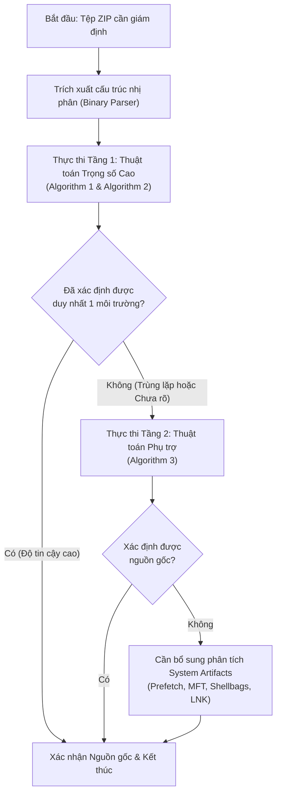

# Cẩm Nang Toàn Diện: Phân Tích Bài Báo Khoa Học & Hướng Dẫn Thực Thi Kỹ Thuật

**Đề tài nghiên cứu:** File Fingerprinting of the ZIP Format for Identifying and Tracking Provenance  
**Tác giả:** Minji Um, Jaehyeok Han, Sangjin Lee (Viện An ninh mạng & Bảo mật ICSP, Đại học Korea, Hàn Quốc)  
**Tạp chí xuất bản:** *Forensic Science International: Digital Investigation*, Tập 39 (2021), Mã bài báo: 301271  
**DOI:** `10.1016/j.fsidi.2021.301271` | **Kho tham khảo tác giả:** `https://github.com/um2inji/PKZIP`  
**Tài liệu biên soạn:** Hướng dẫn kỹ thuật và phương pháp luận chuyên sâu cho kỹ sư phần mềm & giám định viên pháp y số.

---

## MỤC LỤC
1. [Tổng Quan Bài Toán & Động Lực Nghiên Cứu](#1-tổng-quan-bài-toán--động-lực-nghiên-cứu)
2. [Cấu Trúc Nhị Phân Chi Tiết Cấp Byte Của Định Dạng ZIP](#2-cấu-trúc-nhị-phân-chi-tiết-cấp-byte-của-định-dạng-zip)
   - [2.1 Bố cục tổng thể kho lưu trữ ZIP](#21-bố-cục-tổng-thể-kho-lưu-trữ-zip)
   - [2.2 Chi tiết Local File Header (LFH)](#22-chi-tiết-local-file-header-lfh)
   - [2.3 Chi tiết Central Directory Header (CDH)](#23-chi-tiết-central-directory-header-cdh)
   - [2.4 Chi tiết End of Central Directory (EOCD)](#24-chi-tiết-end-of-central-directory-eocd)
   - [2.5 Chi tiết Data Descriptor](#25-chi-tiết-data-descriptor)
3. [Giải Mã Cấu Trúc Nhị Phân Các Trường Mở Rộng (Extra Fields)](#3-giải-mã-cấu-trúc-nhị-phân-các-trường-mở-rộng-extra-fields)
   - [3.1 Bảng 1: Trường NTFS `0x000A` (32 bytes)](#31-bảng-1-trường-ntfs-0x000a-32-bytes)
   - [3.2 Bảng 2: Trường Extended Timestamp `0x5455`](#32-bảng-2-trường-extended-timestamp-0x5455)
   - [3.3 Bảng 3: Trường Info-ZIP UNIX UID/GID `0x7875`](#33-bảng-3-trường-info-zip-unix-uidgid-0x7875)
   - [3.4 Bảng 4: Trường Info-ZIP Unix Extra Field `0x5855`](#34-bảng-4-trường-info-zip-unix-extra-field-0x5855)
   - [3.5 Bảng 5: Trường Info-ZIP Unicode Path Extra Field `0x7075`](#35-bảng-5-trường-info-zip-unicode-path-extra-field-0x7075)
4. [Các Đặc Trưng "Dấu Vân Tay" Cốt Lõi Của Từng Phần Mềm](#4-các-đặc-trưng-dấu-vân-tay-cốt-lõi-của-từng-phần-mềm)
   - [4.1 Ma trận Windows (Bảng 6 bài báo)](#41-ma-trận-windows-bảng-6-bài-báo)
   - [4.2 Ma trận macOS & Ubuntu (Bảng 7 bài báo)](#42-ma-trận-macos--ubuntu-bảng-7-bài-báo)
   - [4.3 Quy tắc làm tròn Nanosecond của WinZip (`fff0000`)](#43-quy-tắc-làm-tròn-nanosecond-của-winzip-fff0000)
   - [4.4 Quy tắc thứ tự các khối Extra Field (Sequence)](#44-quy-tắc-thứ-tự-các-khối-extra-field-sequence)
   - [4.5 Tái nén (Double Zipping)](#45-tái-nén-double-zipping)
   - [4.6 Thư mục `__MACOSX` và chuẩn hóa Unicode (NFD vs NFC)](#46-thư-mục-__macosx-và-chuẩn-hóa-unicode-nfd-vs-nfc)
   - [4.7 Công thức tính độ lệch múi giờ (Timezone Offset)](#47-công-thức-tính-độ-lệch-múi-giờ-timezone-offset)
5. [Logic Chi Tiết Của Bộ Phân Loại 2 Tầng (Lưu Đồ & 3 Thuật Toán)](#5-logic-chi-tiết-của-bộ-phân-loại-2-tầng-lưu-đồ--3-thuật-toán)
   - [5.1 Lưu đồ tổng thể (Hình 7)](#51-lưu-đồ-tổng-thể-hình-7)
   - [5.2 Thuật toán 1: Trọng số cao cho Phần mềm (Algorithm 1)](#52-thuật-toán-1-trọng-số-cao-cho-phần-mềm-algorithm-1)
   - [5.3 Thuật toán 2: Trọng số cao cho Hệ điều hành (Algorithm 2)](#53-thuật-toán-2-trọng-số-cao-cho-hệ-điều-hành-algorithm-2)
   - [5.4 Thuật toán 3: Phân loại phụ trợ trọng số thấp (Algorithm 3)](#54-thuật-toán-3-phân-loại-phụ-trợ-trọng-số-thấp-algorithm-3)
   - [5.5 Cơ chế tính điểm tin cậy tổng hợp (Scoring Formula)](#55-cơ-chế-tính-điểm-tin-cậy-tổng-hợp-scoring-formula)
6. [Cơ Chế Phát Hiện Đa Nguồn Gốc & Can Thiệp Tệp (Mục 4.2 & Hình 10)](#6-cơ-chế-phát-hiện-đa-nguồn-gốc--can-thiệp-tệp-mục-42--hình-10)
   - [6.1 Bản chất việc thêm/xóa/sửa tệp ZIP](#61-bản-chất-việc-thêmxóasửa-tệp-zip)
   - [6.2 Case 1: Can thiệp cục bộ (Vân tay hỗn hợp - Mixed Fingerprints)](#62-case-1-can-thiệp-cục-bộ-vân-tay-hỗn-hợp---mixed-fingerprints)
   - [6.3 Case 2: Thay đổi dây chuyền toàn bộ kho lưu trữ](#63-case-2-thay-đổi-dây-chuyền-toàn-bộ-kho-lưu-trữ)
   - [6.4 Thuật toán kiểm tra tính không đồng nhất (Heterogeneity Detector)](#64-thuật-toán-kiểm-tra-tính-không-đồng-nhất-heterogeneity-detector)
7. [Dấu Vết Thời Gian Giải Nén & Nghịch Đảo Thời Gian (Mục 4.3 & Bảng 8)](#7-dấu-vết-thời-gian-giải-nén--nghịch-đảo-thời-gian-mục-43--bảng-8)
   - [7.1 Ma trận dấu vết BMAC (Bảng 8 bài báo)](#71-ma-trận-dấu-vết-bmac-bảng-8-bài-báo)
   - [7.2 Hiện tượng nghịch đảo thời gian (Time-Reversal Phenomenon)](#72-hiện-tượng-nghịch-đảo-thời-gian-time-reversal-phenomenon)
8. [Cẩm Nang Lập Trình Kỹ Thuật Số (Developer's Implementation Guide)](#8-cẩm-nang-lập-trình-kỹ-thuật-số-developers-implementation-guide)
   - [8.1 Kỹ thuật Little-Endian và unpack byte](#81-kỹ-thuật-little-endian-và-unpack-byte)
   - [8.2 Thuật toán quét ngược tìm EOCD xử lý comment biến thiên](#82-thuật-toán-quét-ngược-tìm-eocd-xử-lý-comment-biến-thiên)
   - [8.3 Giải mã 64-bit Windows FILETIME sang Datetime & Nanoseconds](#83-giải-mã-64-bit-windows-filetime-sang-datetime--nanoseconds)
   - [8.4 Giải mã 32-bit MS-DOS Timestamp](#84-giải-mã-32-bit-ms-dos-timestamp)
   - [8.5 Bảo mật pháp y: Chống Zip Bomb & Path Traversal](#85-bảo-mật-pháp-y-chống-zip-bomb--path-traversal)
9. [Ánh Xạ Sang Kiến Trúc Mã Nguồn Repository](#9-ánh-xạ-sang-kiến-trúc-mã-nguồn-repository)

---

## 1. Tổng Quan Bài Toán & Động Lực Nghiên Cứu

### 1.1 Bài toán trong Điều tra Tội phạm Kỹ thuật số
Khi tiến hành điều tra một vụ rò rỉ dữ liệu (Data Exfiltration) hoặc tấn công mạng bằng mã độc, giám định viên thường thu thập được các tệp nén `.zip`. Các câu hỏi pháp lý then chốt cần trả lời:
1. **Nguồn gốc môi trường tạo (Provenance):** Tệp này được tạo ra từ hệ điều hành nào (Windows, macOS, Ubuntu)? Dùng công cụ nào (WinRAR, WinZip, 7-Zip, Bandizip hay tiện ích mặc định)?
2. **Cục bộ hay Ngoại lai (Local vs. Imported):** Tệp ZIP có thực sự được tạo ra trên máy tính nghi phạm hay được sao chép từ máy khác qua USB / tải về từ Internet?
3. **Lịch sử chỉnh sửa tệp (Tampering / Multi-provenance):** Tệp có bị ai đó mở ra rồi chèn thêm tệp giả mạo, xóa bớt bằng chứng hoặc sửa đổi nội dung sau đó hay không?
4. **Dấu vết giải nén (Decompression Artifacts):** Dựa vào các mốc thời gian của thư mục giải nén trên ổ cứng, có thể chứng minh được nghi phạm đã dùng công cụ nào để giải nén tệp hay không?

### 1.2 Động lực khoa học
Đặc tả định dạng ZIP của PKWARE (`APPNOTE.TXT`) chỉ quy định khung cấu trúc cơ bản. Các nhà phát triển phần mềm nén (RarLab, Igor Pavlov, Bandisoft, Corel, Apple, Canonical) tự do lựa chọn:
* Có sinh các trường mở rộng (Extra Fields) hay không?
* Lưu trường mở rộng ở đầu tệp (Local File Header) hay ở mục lục cuối tệp (Central Directory Header)?
* Thứ tự ghi các trường mở rộng ra sao?
* Lưu độ chính xác thời gian đến đâu (2 giây theo chuẩn DOS, 1 giây theo chuẩn Unix, hay 100 nano giây theo chuẩn NTFS)?
* Xử lý tên tệp Unicode bằng mã UTF-8 chuẩn hay bảng mã địa phương (CP949, Windows-1258)?

Chính những sai khác trong cài đặt chi tiết này tạo nên **"Dấu vân tay tệp" (File Fingerprint)** độc nhất vô nhị.

---

## 2. Cấu Trúc Nhị Phân Chi Tiết Cấp Byte Của Định Dạng ZIP

### 2.1 Bố cục tổng thể kho lưu trữ ZIP
Tệp ZIP không phải là một luồng nén liên tục mà là một tập hợp các khối độc lập:

```text
[Local File Header 1] + [File Data 1] + [Data Descriptor 1 (tùy chọn)]
[Local File Header 2] + [File Data 2] + [Data Descriptor 2 (tùy chọn)]
...
[Central Directory Header 1]
[Central Directory Header 2]
...
[Zip64 End of Central Directory Record (tùy chọn)]
[Zip64 End of Central Directory Locator (tùy chọn)]
[End of Central Directory Record (EOCD)]
```

> [!IMPORTANT]
> Quy tắc đọc ZIP đúng chuẩn là **đọc từ cuối tệp lên**: Định vị `EOCD` -> Lấy offset của `Central Directory` -> Đọc tuần tự các `CDH` -> Dựa vào `local_header_offset` trong từng CDH để nhảy về đầu file đọc các `LFH`.

---

### 2.2 Chi tiết Local File Header (LFH)
* **Kích thước cố định:** 30 bytes (chưa tính filename và extra field).
* **Chữ ký (Signature):** `0x04034B50` (`50 4B 03 04` theo thứ tự byte Little-Endian).

| Offset (Byte) | Kích thước | Kiểu dữ liệu | Tên trường | Ý nghĩa pháp y số |
| :---: | :---: | :---: | :--- | :--- |
| **0** | 4 | `uint32` | **Signature** | Cố định: `0x04034B50` (`PK\x03\x04`). |
| **4** | 2 | `uint16` | **Extract Version** | Phiên bản đặc tả ZIP tối thiểu để giải nén (ví dụ `20` = 2.0). |
| **6** | 2 | `uint16` | **General Purpose Bit Flag** | Cờ trạng thái:<br>• **Bit 3 (`0x0008`):** Bật nếu có Data Descriptor.<br>• **Bit 11 (`0x0800`):** Cờ EFS (Language encoding: UTF-8). |
| **8** | 2 | `uint16` | **Compression Method** | Phương thức nén:<br>• `0`: Store (không nén).<br>• `8`: Deflate. |
| **10** | 2 | `uint16` | **Last Mod File Time** | Giờ sửa đổi cuối (định dạng MS-DOS, độ phân giải 2 giây). |
| **12** | 2 | `uint16` | **Last Mod File Date** | Ngày sửa đổi cuối (định dạng MS-DOS). |
| **14** | 4 | `uint32` | **CRC-32** | Mã kiểm tra toàn vẹn nội dung chưa nén. *(Bị điền 0 nếu có Data Descriptor).* |
| **18** | 4 | `uint32` | **Compressed Size** | Kích thước sau nén. *(Bị điền 0 nếu có Data Descriptor).* |
| **22** | 4 | `uint32` | **Uncompressed Size** | Kích thước gốc trước khi nén. *(Bị điền 0 nếu có Data Descriptor).* |
| **26** | 2 | `uint16` | **File Name Length** ($n$) | Độ dài tên tệp tính bằng byte. |
| **28** | 2 | `uint16` | **Extra Field Length** ($m$) | Độ dài phần trường mở rộng tính bằng byte. |
| **30** | $n$ | `bytes` | **File Name** | Tên tệp tin hoặc đường dẫn tương đối. |
| **30 + $n$** | $m$ | `bytes` | **Extra Field** | Chứa chuỗi các khối Extra Field (nếu có). |

---

### 2.3 Chi tiết Central Directory Header (CDH)
* **Kích thước cố định:** 46 bytes (chưa tính filename, extra field và file comment).
* **Chữ ký (Signature):** `0x02014B50` (`50 4B 01 02` Little-Endian).

| Offset (Byte) | Kích thước | Kiểu dữ liệu | Tên trường | Ý nghĩa pháp y số |
| :---: | :---: | :---: | :--- | :--- |
| **0** | 4 | `uint32` | **Signature** | Cố định: `0x02014B50` (`PK\x01\x02`). |
| **4** | 2 | `uint16` | **Version Made By** | **ĐẶC TRƯNG HỆ ĐIỀU HÀNH TẠO TỆP:**<br>• **Byte cao (Host OS):**<br>&nbsp;&nbsp;- `0x00`: MS-DOS / FAT / Windows<br>&nbsp;&nbsp;- `0x03`: UNIX / Linux / macOS<br>&nbsp;&nbsp;- `0x0A`: Windows NTFS<br>&nbsp;&nbsp;- `0x13`: macOS (OS X)<br>• **Byte thấp:** Phiên bản ZIP tạo tệp. |
| **6** | 2 | `uint16` | **Extract Version** | Phiên bản ZIP tối thiểu để giải nén. |
| **8** | 2 | `uint16` | **General Purpose Bit Flag** | Cờ bit tương tự LFH. |
| **10** | 2 | `uint16` | **Compression Method** | Phương thức nén. |
| **12** | 2 | `uint16` | **Last Mod File Time** | Giờ sửa đổi cuối (MS-DOS). |
| **14** | 2 | `uint16` | **Last Mod File Date** | Ngày sửa đổi cuối (MS-DOS). |
| **16** | 4 | `uint32` | **CRC-32** | Luôn chứa CRC32 chính xác (kể cả khi LFH điền 0). |
| **20** | 4 | `uint32` | **Compressed Size** | Kích thước sau nén thực tế. |
| **24** | 4 | `uint32` | **Uncompressed Size** | Kích thước gốc thực tế. |
| **28** | 2 | `uint16` | **File Name Length** ($n$) | Độ dài tên tệp. |
| **30** | 2 | `uint16` | **Extra Field Length** ($m$) | Độ dài trường mở rộng trong CDH. |
| **32** | 2 | `uint16` | **File Comment Length** ($k$) | Độ dài ghi chú tệp. |
| **34** | 2 | `uint16` | **Disk Number Start** | Số hiệu đĩa bắt đầu chứa tệp (thường là 0). |
| **36** | 2 | `uint16` | **Internal File Attributes** | Thuộc tính nội bộ (ví dụ: cờ văn bản ASCII). |
| **38** | 4 | `uint32` | **External File Attributes** | Thuộc tính hệ thống tệp gốc (DOS attributes hoặc POSIX permissions `st_mode`). |
| **42** | 4 | `uint32` | **Local Header Offset** | Vị trí byte tuyệt đối của LFH tính từ đầu tệp ZIP. |
| **46** | $n$ | `bytes` | **File Name** | Tên tệp tin. |
| **46 + $n$** | $m$ | `bytes` | **Extra Field** | Chuỗi các khối Extra Field trong CDH. |
| **46 + $n$ + $m$** | $k$ | `bytes` | **File Comment** | Ghi chú của tệp. |

---

### 2.4 Chi tiết End of Central Directory (EOCD)
* **Kích thước tối thiểu:** 22 bytes.
* **Chữ ký (Signature):** `0x06054B50` (`50 4B 05 06` Little-Endian).

| Offset (Byte) | Kích thước | Kiểu dữ liệu | Tên trường | Ý nghĩa |
| :---: | :---: | :---: | :--- | :--- |
| **0** | 4 | `uint32` | **Signature** | Cố định: `0x06054B50` (`PK\x05\x06`). |
| **4** | 2 | `uint16` | **Disk Number** | Số hiệu của đĩa hiện tại (0). |
| **6** | 2 | `uint16` | **Start Disk Number** | Số hiệu đĩa bắt đầu bảng Central Directory (0). |
| **8** | 2 | `uint16` | **Total Entries This Disk** | Số lượng tệp/thư mục ghi trên đĩa này. |
| **10** | 2 | `uint16` | **Total Entries** | Tổng số lượng tệp/thư mục trong toàn bộ kho lưu trữ. |
| **12** | 4 | `uint32` | **Central Directory Size** | Kích thước của toàn bộ bảng Central Directory (bytes). |
| **16** | 4 | `uint32` | **Central Directory Offset** | Vị trí byte bắt đầu của CDH đầu tiên từ đầu tệp ZIP. |
| **20** | 2 | `uint16` | **ZIP Comment Length** ($c$) | Độ dài chuỗi ghi chú kho lưu trữ (tối đa 65,535 bytes). |
| **22** | $c$ | `bytes` | **ZIP Comment** | Chuỗi ghi chú kho lưu trữ. |

---

### 2.5 Chi tiết Data Descriptor
Data Descriptor được sinh ra khi phần mềm nén theo dạng luồng (streaming) mà chưa biết trước kích thước và CRC-32 khi ghi LFH:
* Nếu chữ ký xuất hiện: 16 bytes:
  * `0..3` (4 bytes): Chữ ký `0x08074B50` (`PK\x07\x08`).
  * `4..7` (4 bytes): CRC-32.
  * `8..11` (4 bytes): Compressed Size.
  * `12..15` (4 bytes): Uncompressed Size.
* Nếu chữ ký bị lược bỏ (chỉ dựa vào Bit 3): 12 bytes (không có 4 byte chữ ký).

---

## 3. Giải Mã Cấu Trúc Nhị Phân Các Trường Mở Rộng (Extra Fields)

Chuỗi nhị phân Extra Field bao gồm nhiều khối con ghép liên tiếp nhau theo định dạng chuẩn:
$$\text{Block} = [\text{Header ID: 2 bytes}] + [\text{Data Size: 2 bytes}] + [\text{Payload: Data Size bytes}]$$

Dưới đây là cấu trúc chi tiết cấp byte của **5 loại Extra Field** xuất hiện trong bài báo:

### 3.1 Bảng 1: Trường NTFS `0x000A` (32 bytes)
Được sinh ra khi tệp được nén trên hệ thống tệp Windows NTFS để bảo toàn dấu thời gian chính xác 100 nano giây.

| Offset (Byte) | Kích thước | Giá trị mẫu / Kiểu | Tên trường | Ý nghĩa pháp y |
| :---: | :---: | :---: | :--- | :--- |
| **0** | 2 | `0x000A` | **Header ID** | Định danh NTFS Extra Field (`0A 00`). |
| **2** | 2 | `32` (`0x0020`) | **Data Size** | Tổng độ dài dữ liệu payload phía sau. |
| **4** | 4 | `0x00000000` | **Reserved** | 4 byte dành riêng (thường là 0). |
| **8** | 2 | `0x0001` | **Tag 1 (Tag of attribute)** | Định danh phân nhóm thuộc tính thời gian (`01 00`). |
| **10** | 2 | `24` (`0x0018`) | **Size of attribute** | Kích thước của 3 timestamp 64-bit ($3 \times 8 = 24$ bytes). |
| **12** | 8 | `uint64` | **Last Modified Time** | 64-bit Windows FILETIME (UTC+0, 100ns). |
| **20** | 8 | `uint64` | **Last Accessed Time** | 64-bit Windows FILETIME (UTC+0, 100ns). |
| **28** | 8 | `uint64` | **Created Time** | 64-bit Windows FILETIME (UTC+0, 100ns). |

> [!NOTE]
> 64-bit Windows FILETIME đếm số khoảng thời gian 100 nano giây trôi qua kể từ ngày 01/01/1601 UTC. Dữ liệu này được trích xuất trực tiếp từ thuộc tính `$STANDARD_INFORMATION` trong bảng `$MFT`.

---

### 3.2 Bảng 2: Trường Extended Timestamp `0x5455`
Được dùng phổ biến trên macOS và Ubuntu để lưu trữ dấu thời gian Unix 32-bit theo múi giờ UTC+0. Chiều dài biến thiên: 13 bytes, 9 bytes hoặc 5 bytes.

| Offset (Byte) | Kích thước | Kiểu dữ liệu | Tên trường | Chi tiết |
| :---: | :---: | :---: | :--- | :--- |
| **0** | 2 | `uint16` | **Header ID** | Cố định `0x5455` (`UT` trong mã ASCII). |
| **2** | 2 | `uint16` | **Data Size** | Độ dài payload ($1 + 4 \times k$). |
| **4** | 1 | `uint8` | **Flags (Info bits)** | Cờ bit xác định timestamp nào hiện diện:<br>• **Bit 0 (`0x01`):** Có Modified time.<br>• **Bit 1 (`0x02`):** Có Accessed time.<br>• **Bit 2 (`0x04`):** Có Changed time. |
| **5** | 4 | `uint32` | **Last Mod Time** | *(Tùy chọn)* Unix epoch time 32-bit (giây). |
| **9** | 4 | `uint32` | **Last Access Time**| *(Tùy chọn)* Unix epoch time 32-bit (giây). |
| **13** | 4 | `uint32` | **Change Time** | *(Tùy chọn)* Unix epoch time 32-bit (giây). |

* **Độ dài 13 bytes:** Bật cả 3 bit $\rightarrow$ Có cả Mod, Access, Change time.
* **Độ dài 9 bytes:** Bật bit 0 & 1 $\rightarrow$ Có Mod và Access time.
* **Độ dài 5 bytes:** Chỉ bật bit 0 $\rightarrow$ Chỉ có Mod time.

---

### 3.3 Bảng 3: Trường Info-ZIP UNIX UID/GID `0x7875`
Lưu trữ thông tin người dùng và nhóm sở hữu tệp trên hệ thống POSIX (Unix/Linux/macOS).

| Offset (Byte) | Kích thước | Kiểu dữ liệu | Tên trường | Chi tiết |
| :---: | :---: | :---: | :--- | :--- |
| **0** | 2 | `uint16` | **Header ID** | Cố định `0x7875` (`ux` trong ASCII). |
| **2** | 2 | `uint16` | **Data Size** | Kích thước phần payload. |
| **4** | 1 | `uint8` | **Version** | Phiên bản cấu trúc (hiện tại là `1`). |
| **5** | 1 | `uint8` | **UID Size** ($u$) | Kích thước byte của trường UID (thường là 2 hoặc 4). |
| **6** | $u$ | `uint` | **UID** | User ID của tài khoản tạo tệp. |
| **6 + $u$** | 1 | `uint8` | **GID Size** ($g$) | Kích thước byte của trường GID (thường là 2 hoặc 4). |
| **7 + $u$** | $g$ | `uint` | **GID** | Group ID của tài khoản tạo tệp. |

* **Trên macOS:** UID mặc định của người dùng đầu tiên là `501` (`0x01F5`), GID mặc định là `20` (`0x0014` - `staff`).
* **Trên Ubuntu:** Cả UID và GID mặc định đều là `1000` (`0x03E8`).

---

### 3.4 Bảng 4: Trường Info-ZIP Unix Extra Field `0x5855`
Trường cổ điển được **Bandizip trên macOS** sử dụng riêng biệt thay vì dùng `0x7875`.

| Offset (Byte) | Kích thước | Kiểu dữ liệu | Tên trường | Chi tiết |
| :---: | :---: | :---: | :--- | :--- |
| **0** | 2 | `uint16` | **Header ID** | Cố định `0x5855` (`UX` trong ASCII). |
| **2** | 2 | `uint16` | **Data Size** | Thường là 8 bytes (chỉ có time) hoặc 12 bytes. |
| **4** | 4 | `uint32` | **Last Access Time**| Unix epoch time 32-bit. |
| **8** | 4 | `uint32` | **Last Mod Time** | Unix epoch time 32-bit. |
| **12** | 2 | `uint16` | **UID** | *(Tùy chọn)* UID (thường chỉ xuất hiện ở LFH). |
| **14** | 2 | `uint16` | **GID** | *(Tùy chọn)* GID (thường chỉ xuất hiện ở LFH). |

> [!NOTE]
> Điểm đặc biệt của Bandizip trên macOS: Trong LFH, trường này lưu cả thời gian và UID/GID (12 bytes), nhưng trong CDH, nó chỉ lưu 8 bytes thời gian.

---

### 3.5 Bảng 5: Trường Info-ZIP Unicode Path Extra Field `0x7075`
Được các công cụ nén trên Windows (WinRAR, WinZip, Bandizip) sinh ra khi tên tệp có chứa ký tự không phải thuần ASCII (tiếng Hàn, tiếng Việt, tiếng Trung...).

| Offset (Byte) | Kích thước | Kiểu dữ liệu | Tên trường | Chi tiết |
| :---: | :---: | :---: | :--- | :--- |
| **0** | 2 | `uint16` | **Header ID** | Cố định `0x7075` (`up` trong ASCII). |
| **2** | 2 | `uint16` | **Data Size** | Tổng độ dài $5 + \text{len(unicode\_name)}$. |
| **4** | 1 | `uint8` | **Version** | Luôn là `1`. |
| **5** | 4 | `uint32` | **Name CRC-32** | Checksum CRC-32 của chuỗi tên tệp đã lưu trong header chính. |
| **9** | biến thiên | `bytes` | **Unicode File Name** | Tên tệp được mã hóa chuẩn UTF-8. |

---

## 4. Các Đặc Trưng "Dấu Vân Tay" Cốt Lõi Của Từng Phần Mềm

Dưới đây là 2 bảng dữ liệu thực nghiệm chuẩn (Ground Truth) được rút ra từ bài báo:

### 4.1 Ma trận Windows (Bảng 6 bài báo)
Kiểm thử trên Windows 10 (bản tiếng Anh và tiếng Hàn):

| Đặc trưng nhận diện | WinRAR (v6.00) | WinZip (v25.0) | 7-Zip (v19.00) | Bandizip (v6.29) | Windows Built-in |
| :--- | :--- | :--- | :--- | :--- | :--- |
| **Local Extra Field** | EN: Không có<br>KR: `0x7075` | EN: Không có<br>KR: `0x7075` | **Không có** | EN: Không có<br>KR: `0x7075` | **Không có** |
| **Central Extra Field** | EN: `0x000A`<br>KR: `0x000A` + `0x7075` | EN: `0x000A`<br>KR: `0x7075` + `0x000A` | **Chỉ có `0x000A`** | EN: `0x000A`<br>KR: `0x000A` + `0x7075` | **Không có** |
| **Thứ tự Central Extra** | `0x000A` đứng trước | `0x7075` đứng trước | Chỉ có 1 khối | `0x000A` đứng trước | Không có |
| **Mẫu Nanosecond** | `fffffff` (đầy đủ) | `fff0000` (làm tròn) | `fffffff` | `fffffff` | Không có |
| **Bảng mã tên tệp** | EN: UTF-8, KR: CP949 | EN: UTF-8, KR: CP949 | EN: UTF-8, KR: CP949 | EN: UTF-8, KR: CP949 | EN: UTF-8, KR: CP949 |
| **Header thư mục con** | Có tạo | Có tạo | Có tạo | Có tạo | Có tạo |
| **Header thư mục gốc** | **CÓ TẠO** | **CÓ TẠO** | **CÓ TẠO** | **CÓ TẠO** | **KHÔNG TẠO** |
| **Tái nén (Double zip)**| **X** (Không nén lại) | **O** (Có nén lại) | **O** (Có nén lại) | **O** (Có nén lại) | **X** (Không nén lại) |
| **Thứ tự ghi entry** | Theo bảng chữ cái | Theo bảng chữ cái | Theo bảng chữ cái | Theo bảng chữ cái | Theo bảng chữ cái |

---

### 4.2 Ma trận macOS & Ubuntu (Bảng 7 bài báo)
Kiểm thử trên macOS 10.15 và Ubuntu 20.04 LTS:

| Tiêu chí | macOS WinZip | macOS Bandizip | macOS Compress | macOS zip CLI | Ubuntu 7-Zip | Ubuntu Compress | Ubuntu zip CLI |
| :--- | :--- | :--- | :--- | :--- | :--- | :--- | :--- |
| **Local Extra Field** | Không có | `0x5855` | `0x5455`, `0x7875` | `0x5455`, `0x7875` | Không có | `0x5455`, `0x7875` | `0x5455`, `0x7875` |
| **Central Extra Field** | Không có | `0x5855` | `0x5455`, `0x7875` | `0x5455`, `0x7875` | `0x000A` | `0x5455`, `0x7875` | `0x5455`, `0x7875` |
| **Độ dài 0x5455 (Local)**| N/A | N/A | **13 bytes** | **9 bytes** | N/A | **13 bytes** | **9 bytes** |
| **Độ dài 0x5455 (Central)**| N/A | N/A | **13 bytes** | **5 bytes** | N/A | **13 bytes** | **5 bytes** |
| **Tái nén (Double zip)**| O | O | O | **X** | O | O | **X** |
| **Thư mục `__MACOSX`** | N/A | N/A | **CÓ TỒN TẠI** | N/A | N/A | N/A | N/A |
| **Data Descriptor** | N/A | N/A | **CÓ TỒN TẠI** | N/A | N/A | **CÓ TỒN TẠI** | N/A |

---

### 4.3 Quy tắc làm tròn Nanosecond của WinZip (`fff0000`)
Trong trường `0x000A`, Windows FILETIME là một số nguyên 64-bit đếm đơn vị 100ns. Khi chuyển sang định dạng chuỗi thập phân nanosecond:
* Các công cụ như WinRAR, 7-Zip, Bandizip giữ nguyên giá trị độ phân giải cao đọc từ `$MFT`: ví dụ `2021-01-11 11:30:59.1470627`.
* Riêng **WinZip** trên Windows có một cơ chế nội bộ làm tròn/cắt cụt 4 số cuối về 0: ví dụ `2021-01-11 11:30:59.1470000` (dạng `fff0000`).
* Đây là đặc trưng nhận diện chắc chắn 100% của WinZip khi phân biệt với 7-Zip hoặc WinRAR.

---

### 4.4 Quy tắc thứ tự các khối Extra Field (Sequence)
Khi một tệp có tên chứa ký tự Unicode được nén trên Windows, Central Directory Header chứa cả 2 khối: `0x000A` (NTFS time) và `0x7075` (Unicode path):
* **WinRAR và Bandizip:** Ghi khối `0x000A` trước, khối `0x7075` sau:
  $$\text{Central Extra Field} = [\text{0x000A Block}] + [\text{0x7075 Block}]$$
* **WinZip:** Ghi khối `0x7075` trước, khối `0x000A` sau:
  $$\text{Central Extra Field} = [\text{0x7075 Block}] + [\text{0x000A Block}]$$

---

### 4.5 Tái nén (Double Zipping)
Khi mục tiêu cần nén có chứa một tệp `.zip` bên trong:
* **WinRAR và Windows Built-in:** Kiểm tra phần mở rộng tệp. Nếu thấy đuôi `.zip`, chúng mặc định đây là tệp đã nén và **chỉ sao chép nguyên khối nhị phân** (`Compression Method = 0` / Store). Thậm chí nếu bạn lấy một file `.jpg` rồi đổi tên thành `.zip`, WinRAR vẫn không nén lại mà copy thẳng binary vào.
* **WinZip, 7-Zip, Bandizip:** Đánh giá tỷ lệ nén thực tế. Nếu file zip con nén ở mức thấp, chúng sẽ nén lại (`Compression Method = 8` / Deflate).

---

### 4.6 Thư mục `__MACOSX` và chuẩn hóa Unicode (NFD vs NFC)
1. **Thư mục `__MACOSX`:**
   * Hệ thống tệp APFS/HFS+ của Apple sử dụng cơ chế Data fork (chứa dữ liệu) và Resource fork (chứa metadata/icon).
   * Khi người dùng nhấn chuột phải chọn **"Compress"** trên giao diện macOS Finder, hệ điều hành tự động tạo thêm một thư mục ẩn tên là `__MACOSX` chứa các tệp AppleDouble (`._filename`).
   * Nếu dùng lệnh dòng lệnh `zip` trong Terminal của macOS, thư mục `__MACOSX` **không được tạo**.
2. **Chuẩn hóa Unicode (Unicode Normalization):**
   * **macOS:** Sử dụng chuẩn **NFD (Normalization Form D)** - phân rã ký tự. Ký tự tiếng Hàn hoặc ký tự tiếng Việt có dấu sẽ bị tách thành các âm vị rời rạc (ví dụ: chữ `ế` tách thành `e` + dấu nón `^` + dấu sắc `'`).
   * **Windows & Ubuntu:** Sử dụng chuẩn **NFC (Normalization Form C)** - hợp nhất ký tự.
   * Do đó, chỉ cần kiểm tra xem chuỗi byte tên tệp tuân theo NFD hay NFC là biết tệp được gõ và nén trên macOS hay Windows.

---

### 4.7 Công thức tính độ lệch múi giờ (Timezone Offset)
Trường MS-DOS Time trong header lưu theo **giờ địa phương (Local Time)** của chiếc máy tính đã nén tệp. Ngược lại, các trường Extra Field (`0x000A` NTFS, `0x5455` Unix, `0x5855` Bandizip) luôn lưu theo **giờ UTC+0**.

$$\Delta t = \text{Timestamp}_{\text{DOS}} - \text{Timestamp}_{\text{UTC}}$$
$$\text{Timezone Offset} = \text{round}\left(\frac{\Delta t}{15 \text{ phút}}\right) \times 15 \text{ phút}$$

*Ví dụ:* Nếu tệp có DOS time là `19:00:00` và UTC Extra time là `12:00:00`, độ chênh lệch là $+7$ giờ $\rightarrow$ Máy trạm tạo tệp đặt múi giờ **UTC+07:00** (Việt Nam, Thái Lan).

---

## 5. Logic Chi Tiết Của Bộ Phân Loại 2 Tầng (Lưu Đồ & 3 Thuật Toán)

Nhóm tác giả thiết kế bộ phân loại tự động gồm 2 tầng phân cấp theo trọng số để vừa đảm bảo tốc độ, vừa đạt độ chính xác tối đa:

### 5.1 Lưu đồ tổng thể (Hình 7)



---

### 5.2 Thuật toán 1: Trọng số cao cho Phần mềm (Algorithm 1)
Thuật toán này quét các trường có tính chất kỹ thuật cốt lõi bất biến:

```python
procedure estimate_program_1(zip_archive):
    result = []
    
    # 1. Kiểm tra Data Descriptor (Mục 3.3.2)
    if zip_archive.has_data_descriptor():
        result.append("Data descriptor")
        
    # 2. Kiểm tra sự hiện diện của Extra Field (Mục 3.1)
    if zip_archive.local_extra_fields is EMPTY and zip_archive.central_extra_fields is EMPTY:
        result.append("Extra N/A")
        
    if 0x7075 in zip_archive.extra_field_ids:
        result.append("Extra 0x7075")
        
    if 0x000A in zip_archive.extra_field_ids:
        result.append("Extra 0x000A")
        
    if 0x5855 in zip_archive.extra_field_ids:
        result.append("Extra 0x5855")
        
    if 0x5455 in zip_archive.extra_field_ids:
        # Ghi nhận độ dài cụ thể của trường 0x5455 (13 bytes, 9 bytes, hay 5 bytes)
        length = zip_archive.get_extra_field_length(0x5455)
        result.append(f"Extra 0x5455, length={length}")
        
    if 0x7875 in zip_archive.extra_field_ids:
        result.append("Extra 0x7875")
        
    return result
```

---

### 5.3 Thuật toán 2: Trọng số cao cho Hệ điều hành (Algorithm 2)
Thuật toán này đọc thuộc tính `version_made_by` ở Central Directory Header:

```python
procedure estimate_program_2(zip_archive):
    result = []
    
    # Byte cao của version_made_by xác định Host OS
    host_os = (zip_archive.cdh.version_made_by >> 8) & 0xFF
    
    if host_os == 0x00:
        result.append("Windows")
    elif host_os == 0x03:
        result.append("macOS/Ubuntu")
        
    return result
```

---

### 5.4 Thuật toán 3: Phân loại phụ trợ trọng số thấp (Algorithm 3)
Được kích hoạt khi kết hợp Algorithm 1 & 2 chưa chọn ra được 1 ứng viên duy nhất:

```python
procedure estimate_program_3(zip_archive):
    result = []
    
    # 1. Kiểm tra tái nén (Mục 3.2.2)
    if zip_archive.has_double_zipping():
        result.append("double zipping")
        
    # 2. Kiểm tra thư mục __MACOSX (Mục 3.3.1)
    if zip_archive.contains_entry("__MACOSX/"):
        result.append("__MACOSX")
        
    # 3. Kiểm tra dạng nanosecond trong trường 0x000A (Mục 3.1.1)
    nano_pattern = zip_archive.get_nanosecond_pattern()
    if nano_pattern == "fff0000":
        result.append("fff0000")       # Dấu hiệu chắc chắn của WinZip trên Windows
    elif nano_pattern == "fffffff":
        result.append("fffffff")       # WinRAR, 7-Zip, Bandizip
    elif nano_pattern == "0000000":
        result.append("0000000")
        
    # 4. Kiểm tra chuẩn hóa Unicode và bảng mã (Mục 3.1.3)
    if zip_archive.unicode_form == "NFC":
        result.append("Ubuntu/Windows")
    elif zip_archive.unicode_form == "NFD":
        result.append("macOS")
        
    if zip_archive.encoding == "CP949":
        result.append("Windows")
        
    # 5. Kiểm tra sự tồn tại của header thư mục gốc (Mục 3.2.1)
    if zip_archive.root_folder_header_exists:
        result.append("folder header")
        
    # 6. Kiểm tra UID/GID (Mục 3.1.2)
    uid, gid = zip_archive.get_uid_gid()
    if (uid, gid) == (501, 20):
        result.append("macOS_default_id")
    elif (uid, gid) == (1000, 1000):
        result.append("ubuntu_default_id")
        
    # 7. Kiểm tra thứ tự sắp xếp tệp (Mục 3.2.3)
    if zip_archive.is_alphabetical_order():
        result.append("alphabetical")
        
    return result
```

---

### 5.5 Cơ chế tính điểm tin cậy tổng hợp (Scoring Formula)
Mỗi ứng viên môi trường $E_i = (\text{OS}_i, \text{App}_i)$ được tính điểm tin cậy theo công thức:

$$\text{Score}(E_i) = w_{\text{high}} \cdot \sum_{r \in R_{\text{high}}} \mathbb{I}(r \text{ matches } E_i) + w_{\text{sub}} \cdot \sum_{s \in R_{\text{sub}}} \mathbb{I}(s \text{ matches } E_i)$$

Trong đó:
* $w_{\text{high}} = 1.0$ (trọng số của các luật Tầng 1: Host OS, Extra Field IDs, Độ dài trường, Data Descriptor).
* $w_{\text{sub}} = 0.2$ (trọng số của các luật Tầng 2: Nanosecond pattern, Double zipping, `__MACOSX`, NFD/NFC, UID/GID).
* $\mathbb{I}(\cdot)$ là hàm chỉ thị nhận giá trị $1$ nếu khớp và $0$ nếu không khớp.
* Ứng viên có $\text{Score}(E_i)$ cao nhất sẽ được chọn là kết quả nhận diện chính.

---

## 6. Cơ Chế Phát Hiện Đa Nguồn Gốc & Can Thiệp Tệp (Mục 4.2 & Hình 10)

### 6.1 Bản chất việc thêm/xóa/sửa tệp ZIP
Hầu hết các phần mềm nén đều hỗ trợ người dùng kéo thả để thêm tệp mới, xóa một tệp con, hoặc sửa nội dung tệp mà **không cần giải nén toàn bộ kho lưu trữ**. Nhóm tác giả đã tiến hành thực nghiệm để quan sát xem điều gì xảy ra ở cấp độ nhị phân:

```text
Giả sử:
Kho lưu trữ ban đầu được tạo bởi SW1 (ví dụ 7-Zip trên Windows).
Người dùng đem file này sang một máy tính khác và dùng SW2 (ví dụ WinRAR) để thao tác.
```

Tác giả phát hiện ra có **2 trường hợp (Case) nhị phân** xảy ra:

---

### 6.2 Case 1: Can thiệp cục bộ (Vân tay hỗn hợp - Mixed Fingerprints)
Xảy ra khi người dùng **Thêm tệp mới (Add)** hoặc **Sửa đổi tệp có sẵn (Modify)**:

```text
Ban đầu (Tạo bởi SW1):
  [LFH 1 - SW1] -> [LFH 2 - SW1] -> [CDH 1 - SW1] -> [CDH 2 - SW1] -> [EOCD]

(a) Thêm tệp 3 bằng SW2:
  [LFH 1 - SW1] -> [LFH 2 - SW1] -> [LFH 3 - SW2] -> 
  [CDH 1 - SW1] -> [CDH 2 - SW1] -> [CDH 3 - SW2] -> [EOCD]

(c) Sửa đổi tệp 2 bằng SW2:
  [LFH 1 - SW1] -> [MOD: LFH 2 - SW2] -> 
  [CDH 1 - SW1] -> [MOD: CDH 2 - SW2] -> [EOCD]
```

* **Hiện tượng nhị phân:**
  * Phần mềm SW2 chỉ ghi đè hoặc chèn thêm Local File Header và Central Directory Header cho **chính tệp được thao tác**.
  * Các tệp cũ còn lại **hoàn toàn giữ nguyên header được tạo bởi SW1**.
* **Ý nghĩa pháp y số cực lớn:**
  * Trong cùng 1 tệp ZIP tồn tại **nhiều dấu vân tay khác nhau**.
  * Ví dụ: Tệp 1 có Host OS = Windows, không có trường `0x5455`; tệp 3 lại có Host OS = Unix, có trường `0x5455` (13 bytes) và `0x7875`.
  * Giám định viên có thể khẳng định chắc chắn 100%: **Tệp ZIP này đã được tạo ra trên máy tính A, sau đó bị mang sang máy tính B để chèn thêm tệp 3!**

---

### 6.3 Case 2: Thay đổi dây chuyền toàn bộ kho lưu trữ
Xảy ra trong một số ứng dụng khi người dùng thực hiện thao tác **Xóa tệp (Delete)**:

```text
Ban đầu (Tạo bởi SW1 có Extra Fields):
  [LFH 1 - SW1] -> [LFH 2 - SW1] -> [CDH 1 - SW1] -> [CDH 2 - SW1] -> [EOCD]

(b) Xóa tệp 2 bằng SW2:
  SW2 tái cấu trúc lại bảng Central Directory:
  - Header của tệp 2 bị xóa bỏ.
  - SW2 cập nhật lại CDH 1, đồng thời XÓA BỎ toàn bộ Extra Fields của tệp 1 còn lại
    để ép theo chuẩn lưu trữ mặc định của SW2!
```

* **Hiện tượng nhị phân:**
  * Toàn bộ kho lưu trữ bị đồng bộ hóa lại theo quy tắc của SW2.
  * Tuy nhiên, nếu so sánh giữa LFH của tệp 1 (ở đầu file) và CDH của tệp 1 (ở cuối file), giám định viên sẽ thấy **sự không nhất quán (Discrepancy)**: LFH vẫn giữ cấu trúc cũ, nhưng CDH đã bị thay đổi!

---

### 6.4 Thuật toán kiểm tra tính không đồng nhất (Heterogeneity Detector)

```python
procedure check_provenance_tampering(zip_archive):
    fingerprints = []
    
    for entry in zip_archive.entries:
        fp = extract_entry_fingerprint(entry)
        fingerprints.append(fp)
        
    unique_fingerprints = set(fingerprints)
    
    if len(unique_fingerprints) > 1:
        return {
            "status": "TAMPERED / MULTI-PROVENANCE",
            "case": "Case 1: Localized manipulation",
            "evidence": "Multiple distinct software fingerprints co-exist in single archive",
            "details": unique_fingerprints
        }
        
    if zip_archive.has_lfh_cdh_discrepancy():
        return {
            "status": "TAMPERED / MODIFIED",
            "case": "Case 2: Cascade rewrite discrepancy",
            "evidence": "Mismatch between LFH extra fields and CDH extra fields"
        }
        
    return {"status": "INTECT / SINGLE-PROVENANCE"}
```

---

## 7. Dấu Vết Thời Gian Giải Nén & Nghịch Đảo Thời Gian (Mục 4.3 & Bảng 8)

Khi một tệp ZIP được giải nén ra hệ thống tệp Windows NTFS, hệ điều hành ghi nhận 4 mốc thời gian trong thuộc tính `$STANDARD_INFORMATION` của bảng `$MFT`:
* **B (Birth / Creation Time):** Thời gian tạo tệp.
* **M (Last Modification Time):** Thời gian sửa đổi nội dung lần cuối.
* **A (Last Access Time):** Thời gian truy cập lần cuối.
* **C (MFT Entry Change Time):** Thời gian bản ghi MFT bị thay đổi.

Quy ước ký hiệu trong Bảng 8 bài báo:
* **`R` (Real time):** Thời điểm giải nén thực tế (thời gian hiện tại của đồng hồ hệ thống).
* **`H` (Header time):** Thời gian ghi trong trường MS-DOS ở header của tệp ZIP.
* **`E` (Extra field time):** Thời gian lưu trong trường mở rộng (`0x000A`, `0x5455`, `0x5855`).

### 7.1 Ma trận dấu vết BMAC (Bảng 8 bài báo)
Thứ tự các mốc thời gian được biểu diễn theo chuẩn **B - M - A - C**:

| Đối tượng giải nén | Trạng thái Extra Field | WinRAR | WinZip | 7-Zip | Bandizip | Windows Built-in |
| :--- | :--- | :---: | :---: | :---: | :---: | :---: |
| **File thông thường** | Không có Extra Field | **R H R R** | **H H H R** | **R H R R** | **R H R R** | **H H H R** |
| | Có NTFS `0x000A` | **R E R R** | **E E E R** | **E E E R** | **E E E R** | **H H H R** |
| | Có Extended `0x5455` | **R E R R** | **H H H R** | **R E R R** | **R H R R** | **H H H R** |
| | Có Unix `0x5855` | **R H R R** | **H H H R** | **R E E R** | **R H R R** | **H H H R** |
| **Thư mục có chứa file**| Không có Extra Field | **R H R R** | **H R R R** | **R H R R** | **R R R R** | **R R R R** |
| | Có NTFS `0x000A` | **R E R R** | **E R R R** | **E E E R** | **E R R R** | **R R R R** |
| | Có Extended `0x5455` | **R E R R** | **H R R R** | **R E R R** | **R R R R** | **R R R R** |
| | Có Unix `0x5855` | **R H R R** | **H R R R** | **R E E R** | **R R R R** | **R R R R** |
| **Thư mục rỗng** | Không có Extra Field | **R H R R** | **H H H R** | **R H R R** | **R H R R** | **R H R R** |
| | Có NTFS `0x000A` | **R E R R** | **E E E R** | **E E E R** | **E E E R** | **R H R R** |
| | Có Extended `0x5455` | **R E R R** | **H H H R** | **R E R R** | **R H R R** | **R H R R** |
| | Có Unix `0x5855` | **R H R R** | **H H H R** | **R E E R** | **R H R R** | **R H R R** |

---

### 7.2 Hiện tượng nghịch đảo thời gian (Time-Reversal Phenomenon)
1. **Nghịch đảo Creation Time vs. Modification Time:**
   * Thông thường trên Windows, một tệp được tạo ra trước rồi mới sửa đổi, nên: $\text{Creation Time} \le \text{Modification Time}$.
   * Khi dùng **WinRAR** giải nén tệp có chứa `0x000A`:
     * Creation Time ($B$) nhận giá trị **`R`** (thời điểm hiện tại khi giải nén, ví dụ `2026-10-26 10:00:00`).
     * Modification Time ($M$) nhận giá trị **`E`** (thời điểm tạo file gốc nhiều năm trước, ví dụ `2021-01-11 11:30:59`).
     * Dẫn đến: **Creation Time muộn hơn Modification Time tới 5 năm!**
2. **Nghịch đảo Thư mục Cha vs. Thư mục Con:**
   * Khi giải nén một cây thư mục, thư mục con được tạo ra sau thư mục cha.
   * Nhưng do một số công cụ cập nhật lại Modification Time của thư mục sau khi toàn bộ tệp con đã được ghi xong, dẫn đến thời gian ghi nhận của thư mục con lại sớm hơn thư mục cha.

> [!TIP]
> **Ý nghĩa thực tế:** Khi điều tra một chiếc máy tính nghi phạm, chỉ cần chạy một script kiểm tra các mẫu thời gian BMAC trên thư mục, giám định viên có thể xác định chính xác phần mềm giải nén đã được sử dụng mà không cần tìm file nhật ký hay prefetch!

---

## 8. Cẩm Nang Lập Trình Kỹ Thuật Số (Developer's Implementation Guide)

### 8.1 Kỹ thuật Little-Endian và unpack byte
Định dạng ZIP sử dụng thứ tự byte **Little-Endian** (byte có trọng số thấp đứng trước). Trong Python, ta dùng ký tự `<` trong module `struct`:

```python
import struct

# Đọc chữ ký 4 bytes:
signature = struct.unpack("<I", buffer[0:4])[0]

# Đọc cấu trúc cố định 30 bytes của Local File Header:
(
    sig, extract_ver, gp_flag, comp_method,
    mod_time, mod_date, crc32, comp_size,
    uncomp_size, name_len, extra_len
) = struct.unpack("<IHHHHHIIIHH", buffer[0:30])
```

---

### 8.2 Thuật toán quét ngược tìm EOCD xử lý comment biến thiên
Bản ghi EOCD nằm ở cuối tệp nhưng có trường comment với chiều dài tối đa $65,535$ bytes. Do đó, vị trí của EOCD có thể nằm trong khoảng $22$ đến $22 + 65,535 = 65,557$ bytes tính từ cuối tệp.

```python
def find_eocd_offset(file_handle, file_size: int) -> int:
    """Quét ngược từ cuối tệp để tìm chữ ký EOCD 0x06054B50."""
    scan_size = min(file_size, 65557)
    file_handle.seek(file_size - scan_size)
    data = file_handle.read(scan_size)
    
    # Tìm kiếm chuỗi byte b"PK\x05\x06" từ phải qua trái
    offset_in_buf = data.rfind(b"\x50\x4b\x05\x06")
    if offset_in_buf == -1:
        raise CorruptZipError("Không tìm thấy chữ ký EOCD hợp lệ.")
        
    return (file_size - scan_size) + offset_in_buf
```

---

### 8.3 Giải mã 64-bit Windows FILETIME sang Datetime & Nanoseconds
64-bit FILETIME lưu số lượng khoảng thời gian 100ns kể từ `1601-01-01 00:00:00 UTC`:

```python
from datetime import datetime, timezone

WINDOWS_EPOCH_DELTA_US = 11644473600000000  # Số microsecond từ 1601 đến 1970

def parse_windows_filetime(filetime_64: int):
    """Chuyển đổi 64-bit FILETIME sang datetime UTC và trích xuất mẫu nanosecond."""
    # 1 khoảng = 100ns = 0.1us
    microseconds = filetime_64 // 10
    unix_microseconds = microseconds - WINDOWS_EPOCH_DELTA_US
    dt = datetime.fromtimestamp(unix_microseconds / 1_000_000, tz=timezone.utc)
    
    # Trích xuất 4 ký tự hex thấp của phần dư nanosecond để kiểm tra pattern WinZip
    low_16_bits = filetime_64 & 0xFFFF
    if low_16_bits == 0:
        pattern = "fff0000"  # Đặc trưng WinZip
    else:
        pattern = "fffffff"  # Độ phân giải đầy đủ
        
    return dt, pattern
```

---

### 8.4 Giải mã 32-bit MS-DOS Timestamp
MS-DOS đóng gói ngày và giờ vào hai số nguyên 16-bit:

```python
def parse_msdos_datetime(dos_time: int, dos_date: int) -> datetime:
    """Giải mã mốc thời gian MS-DOS 32-bit."""
    second = (dos_time & 0x1F) * 2
    minute = (dos_time >> 5) & 0x3F
    hour = (dos_time >> 11) & 0x1F
    
    day = dos_date & 0x1F
    month = (dos_date >> 5) & 0x0F
    year = ((dos_date >> 9) & 0x7F) + 1980
    
    # Ràng buộc giá trị hợp lệ đề phòng tệp lỗi
    month = max(1, min(12, month))
    day = max(1, min(31, day))
    hour = min(23, hour)
    minute = min(59, minute)
    second = min(59, second)
    
    return datetime(year, month, day, hour, minute, second)
```

---

### 8.5 Bảo mật pháp y: Chống Zip Bomb & Path Traversal
Khi xây dựng công cụ phân tích chứng cứ số, tệp ZIP được kiểm tra có thể là bẫy của tội phạm nhằm làm sập máy giám định viên:
1. **Chống Zip Bomb (Decompression Bomb):**
   * Module của chúng ta **tuyệt đối không giải nén nội dung payload** ra đĩa cứng.
   * Mọi thao tác chỉ đọc tiêu đề (metadata) nhị phân của các header.
2. **Chống Directory Traversal (`Zip Slip`):**
   * Nếu tên file trong header chứa các đường dẫn nguy hiểm như `../../Windows/System32/evil.dll`, bộ phân tích ghi nhận cảnh báo an ninh (`SecurityWarning`), chuẩn hóa tên hiển thị và không bao giờ ghi tệp ra đường dẫn đó.

---

## 9. Ánh Xạ Sang Kiến Trúc Mã Nguồn Repository

Toàn bộ các nội dung khoa học nêu trên đã được cấu trúc vào các module mã nguồn trong repo của chúng ta:

```text
src/zip_fingerprint/
├── constants.py       # Chứa toàn bộ Magic signatures, Extra Field IDs (Bảng 1-5), Host OS
├── models.py          # Dataclasses biểu diễn LFH, CDH, EOCD, ExtraFieldBlock
├── exceptions.py      # Ngoại lệ CorruptZipError, UnsupportedZipFeatureError
├── parser.py          # ZipBinaryParser: Đọc nhị phân nguyên thủy từ cuối tệp (EOCD -> CDH -> LFH)
├── extra_fields.py    # ExtraFieldParser: Giải mã 0x000A, 0x5455, 0x7875, 0x5855, 0x7075
├── extractor.py       # StructuralFeatureExtractor: Trích xuất vector đặc trưng phân tầng
├── schema.py          # FingerprintSchemaV1: Định dạng JSON chuẩn hóa Pydantic
├── hasher.py          # compute_structural_hash: Sinh mã băm SHA-256 xác định
├── rules.py           # Mã hóa Bảng 6 (Windows) và Bảng 7 (macOS/Ubuntu)
├── classifier.py      # AutomatedClassifier: Thực thi Algorithm 1, 2 và 3 theo Hình 7
├── provenance.py      # ProvenanceTracker: Phân tích can thiệp tệp Case 1 & Case 2 (Hình 10)
├── decompression.py   # DecompressionAnalyzer: Đánh giá BMAC và Time Reversal (Bảng 8)
└── cli.py             # Giao diện dòng lệnh hoàn chỉnh zip-fingerprint
```

---
*Tài liệu được khởi tạo và lưu trữ cố định tại:* [`docs/research/comprehensive-paper-guide.md`](file:///c:/Users/OMEN/Documents/LHB/HK_Vlll/pc/pj/zip-fingerprinting/docs/research/comprehensive-paper-guide.md)

