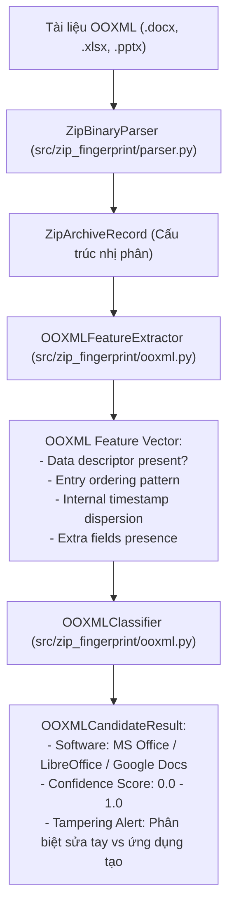

# Nghiên cứu Mở rộng: Định danh Dấu vân tay Nguồn gốc Tài liệu Văn phòng OOXML & Java Archive (OOXML Provenance Extension)

**Dự án:** File Fingerprinting of the ZIP Format for Identifying and Tracking Provenance  
**Bài báo gốc:** Minji Um, Jaehyeok Han, Sangjin Lee. *Forensic Science International: Digital Investigation*, Volume 39, Article 301271, Tháng 12/2021.  
**Tác giả đề xuất mở rộng:** Nhóm nghiên cứu dự án `zip-fingerprint`  
**Ngày khởi tạo:** 29/10/2026  
**Trạng thái:** Bản thiết kế đề xuất nghiên cứu mở rộng (Extension Research Proposal & Technical Specification)

---

## 1. Bối cảnh Khoa học và Động lực Nghiên cứu

### 1.1 Điểm khuyết trong công trình nghiên cứu gốc
Trong bài báo khoa học chính thức (Mục 5 - *Conclusion and future work*), nhóm tác giả Minji Um et al. đã chỉ rõ hướng mở rộng tất yếu nhưng chưa kịp thực hiện:

> *"OOXML and JAR (Java Archive) formats are typical examples of sharing the same structure with a ZIP file format. In particular, OOXML can be created through various applications such as MS Office or LibreOffice. Depending on the applications, each OOXML has a different structure with the existence of a data descriptor, an extra field in the local file header, etc. By using these structural differences, it is possible to determine the application that created the file. These characteristics reveal a possibility of identifying the source of document files. Therefore, a further study will proceed to analyze a method of investigating the source of document files."*

Mặc dù tác giả đã nhận diện được tiềm năng to lớn này, nghiên cứu gốc dừng lại ở các tệp nén thông thường (`.zip`) mà chưa xây dựng ma trận đặc trưng, thuật toán phân loại và bộ dữ liệu thực nghiệm cho các tệp tài liệu văn phòng dạng gói nén.

### 1.2 Ý nghĩa thực tiễn trong Giám định Kỹ thuật số (Digital Forensics)
Trong thực tế điều tra án kinh tế, an ninh mạng và gian lận nội bộ:
- Đối tượng thường phát tán hợp đồng giả mạo, tài liệu tống tiền, hoặc văn bản rò rỉ bí mật công nghệ dưới định dạng `.docx` hoặc `.xlsx`.
- Phần mềm soạn thảo để lại dấu vết nhị phân rất khó xóa nếu chỉ dùng các công cụ làm sạch metadata thông thường (như xóa Author, Last Modified By trong Word Properties).
- Kẻ tấn công có thể sửa đổi nội dung XML bên trong tài liệu bằng script tự động hoặc dùng phần mềm nguồn mở (LibreOffice / Python-docx / Google Docs export) rồi đổi tên nhằm giả vờ tài liệu được tạo từ Microsoft Word chính chủ.
- **Mục tiêu mở rộng:** Áp dụng trực tiếp bộ khung phân tích nhị phân cấp thấp (`ZipBinaryParser`, `StructuralFeatureExtractor`, `CanonicalHasher`) đã hoàn thiện ở Giai đoạn 1 & 2 để xác định chính xác ứng dụng đã tạo ra hoặc can thiệp vào tài liệu văn phòng.

---

## 2. Bản chất Kiến trúc Open Packaging Conventions (OPC / OOXML)

Định dạng Office Open XML (chuẩn ECMA-376 / ISO/IEC 29500) và Java Archive (JAR) đều dựa trên chuẩn đóng gói **ZIP container**:

```text
Tai_Lieu_Hop_Dong.docx (ZIP Container)
├── [Content_Types].xml               # Khai báo kiểu MIME của toàn bộ phần tử bên trong
├── _rels/
│   └── .rels                         # Mối quan hệ mức gói (Package-level relationships)
├── word/                             # Dữ liệu nghiệp vụ chính (hoặc xl/ cho Excel, ppt/ cho PowerPoint)
│   ├── document.xml                  # Nội dung văn bản
│   ├── fontTable.xml
│   ├── settings.xml
│   └── styles.xml
└── docProps/
    ├── app.xml                       # Tên ứng dụng, phiên bản (dễ bị giả mạo / anti-forensics)
    └── core.xml                      # Creator, thời gian tạo/sửa (dễ bị làm giả)
```

> [!IMPORTANT]
> **Điểm đột phá pháp y:**
> Các thuộc tính trong `docProps/app.xml` (như `<Application>Microsoft Office Word</Application>`) là dữ liệu ngữ nghĩa mức cao, **rất dễ bị kẻ xấu chỉnh sửa thủ công**.
> Ngược lại, **cấu trúc nhị phân của các header ZIP đóng gói tệp DOCX** (thứ tự entry, Data descriptor, Extra Fields, phương thức nén, chỉ số MS-DOS timestamp) được sinh ra tự động bởi bộ engine nén tầng dưới của từng phần mềm và **gần như không thể làm giả nếu không hiểu sâu về cấu trúc cấp byte**.

---

## 3. Không gian Các Ứng Dụng Soạn Thảo Mục Tiêu

Nghiên cứu mở rộng này tập trung vào 5 hệ sinh thái phần mềm văn phòng phổ biến nhất hiện nay:

1. **Microsoft Office (Desktop Word / Excel / PowerPoint):**
   - Môi trường: Windows 10/11 & macOS.
   - Đặc trưng nén: Sử dụng thư viện đóng gói nhị phân nội bộ của Microsoft.
2. **LibreOffice / OpenOffice:**
   - Môi trường: Đa nền tảng (Linux, Windows, macOS).
   - Đặc trưng nén: Sử dụng thư viện `libzip` hoặc nén native POSIX.
3. **Google Workspace (Google Docs / Sheets xuất khẩu ra `.docx` / `.xlsx`):**
   - Môi trường: Điện toán đám mây (Google Cloud backend).
   - Đặc trưng nén: Cơ chế nén luồng trực tuyến (Streaming Zip Writer), thường tạo Data descriptor cho mọi entry.
4. **WPS Office (Kingsoft):**
   - Môi trường: Windows / Android / Linux.
   - Bộ engine đóng gói có sự khác biệt về bảng mã và thứ tự lưu trữ entry.
5. **Apple Pages / Keynote / Numbers (khi Export sang Word/Excel):**
   - Môi trường: macOS.
   - Thường để lại đặc trưng của hệ thống HFS+/APFS hoặc các trường mở rộng Apple.

---

## 4. Ma Trận Đặc Trưng Dấu Vân Tay Dự Kiến Cho OOXML

Dựa trên khảo sát cấu trúc nhị phân của các file tài liệu mẫu, ma trận phân loại sẽ khai thác 6 chiều đặc trưng cốt lõi:

| Tiêu chí Nhận diện (Identifier) | Microsoft Office (Desktop) | LibreOffice Writer | Google Docs (Export docx) | WPS Office | Thư viện Tự động (python-docx) |
| :--- | :--- | :--- | :--- | :--- | :--- |
| **Vị trí entry `[Content_Types].xml`** | Cố định là entry đầu tiên | Cố định là entry đầu tiên | Thường không đứng đầu | Cố định đầu tiên | Đứng đầu |
| **Sự hiện diện Data Descriptor** | Thường **KHÔNG CÓ** | Thường **KHÔNG CÓ** | **CÓ TỒN TẠI** (`0x08074B50`) | Không có | Không có |
| **Thứ tự các thư mục con** | `_rels/` $\rightarrow$ `docProps/` $\rightarrow$ `word/` | `word/` $\rightarrow$ `_rels/` $\rightarrow$ `docProps/` | Phụ thuộc luồng nén | Tương tự Office | Theo thứ tự thêm vào |
| **Đặc trưng Extra Fields** | Không có Extra Field ở LFH | Có thể có trường `0x5455` trên Linux | Không có | Không có | Không có |
| **Tính đồng nhất của Timestamp** | Mọi entry bên trong có timestamp khác nhau (thời điểm ghi đĩa) | Timestamp các entry có thể đồng nhất | Tất cả entry có **timestamp hoàn toàn giống nhau** | Timestamp khác nhau | Thường lấy giờ hệ thống hiện tại |
| **Mức nén Compression Method** | Deflate (Method 8, Normal) | Deflate (Method 8, Maximum) | Deflate (Method 8) | Deflate | Deflate |

---

## 5. Kiến Trúc Kỹ Thuật Đề Xuất Tích Hợp Vào Repository

Hệ thống mở rộng sẽ được tổ chức thành module chuyên biệt `src/zip_fingerprint/ooxml.py`, tái sử dụng toàn bộ nền tảng sẵn có:



---

## 6. Kế Hoạch Triển Khai Chi Tiết (Phase 8 Backlog)

Kế hoạch được cấu trúc thành 3 nhiệm vụ kỹ thuật chi tiết:

### `PH8-OOXML-001`: Khảo sát & Xây dựng Bộ mẫu Thực nghiệm Tài liệu Đa Ứng dụng
- **Mục tiêu:** Tạo bộ mẫu đối chứng gồm tối thiểu 25 tài liệu (`.docx`, `.xlsx`) được sinh từ 5 phần mềm khác nhau (MS Word, LibreOffice Writer, Google Docs, WPS Office, python-docx) với cùng một văn bản mẫu.
- **Đầu ra:** Thư mục `data/ooxml_corpus/` kèm tệp `data/ooxml_metadata.json`.

### `PH8-OOXML-002`: Thiết kế Module Bóc tách Cấu trúc Gói OPC & Dấu vân tay Tài liệu (`ooxml.py`)
- **Mục tiêu:** Xây dựng `OOXMLFeatureExtractor` nhận diện các đặc trưng đặc thù của tài liệu văn phòng (vị trí `[Content_Types].xml`, độ phân tán thời gian giữa các sub-entry, sự tồn tại của Data descriptor trong streaming zip).
- **Đầu ra:** File `src/zip_fingerprint/ooxml.py` và kiểm thử đơn vị `tests/unit/test_ooxml.py`.

### `PH8-OOXML-003`: Xây dựng Ma trận Luật Phân loại & Tích hợp vào CLI
- **Mục tiêu:** Xây dựng bộ luật nhận diện phần mềm soạn thảo văn bản, hỗ trợ cờ lệnh `zip-fingerprint --ooxml <file.docx>` xuất báo cáo phân tích nguồn gốc văn bản.
- **Đầu ra:** Bộ phân loại `OOXMLClassifier` và kiểm thử tích hợp đạt độ chính xác $\ge 95\%$.

---

## 7. Tài Liệu Tham Khảo Học Thuật

1. Minji Um, Jaehyeok Han, Sangjin Lee. *File fingerprinting of the ZIP format for identifying and tracking provenance*. Forensic Science International: Digital Investigation, 39, 2021, 301271.
2. Fu, Z., Sun, X., Liu, Y., Li, B., 2011. *Forensic investigation of ooxml format documents*. Digital Investigation, 8 (1), 48–55.
3. Joun, J., Chung, H., Park, J., Lee, S., 2021. *Relevance analysis using revision identifier in MS Word*. Journal of Forensic Sciences, 66 (1), 323–335.
4. ECMA International, 2014. *Standard ECMA-376: Office Open XML File Formats*. 4th edition.
