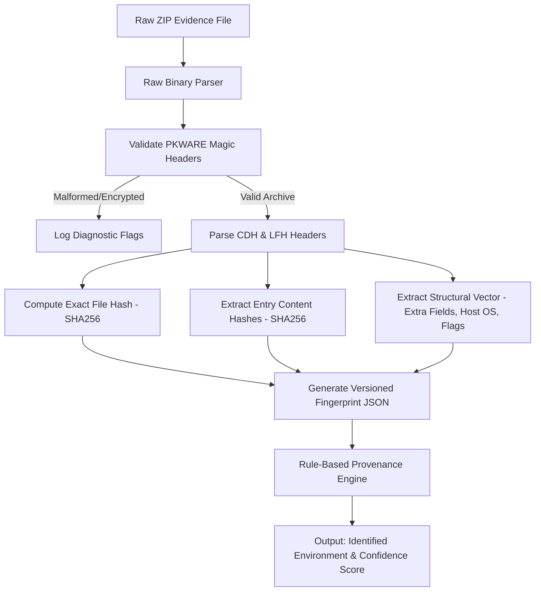

# Phương pháp Luận Tái hiện Nghiên cứu Khoa học (Reproduction Methodology)

**Dự án:** File Fingerprinting of the ZIP Format for Identifying and Tracking Provenance  
**Mục tiêu:** Tái hiện phương pháp nhận diện nguồn gốc môi trường tạo lập tệp ZIP và truy nguyên dấu vết giải nén theo nghiên cứu của Um et al. (2021).  

---

## 1. Mục tiêu và Phạm vi Tái hiện (Scope of Reproduction)

### 1.1 Khả năng 1: Nhận diện tệp chính xác (Exact File Identification)
- **Mục tiêu:** Xác định hai tệp ZIP có trùng khớp tuyệt đối từng byte hay không.
- **Phương pháp:** Băm mật mã học (SHA-256) trên toàn bộ chuỗi byte của tệp lưu trữ.
- **Phân loại vai trò:** Lớp cơ sở (baseline) để kiểm tra tính toàn vẹn chứng cứ số; không chứng minh nguồn gốc nếu tệp bị nén lại.

### 1.2 Khả năng 2: Định danh cấp độ Entry (Entry-Level Fingerprinting)
- **Mục tiêu:** Xác định danh mục và nội dung các tệp con bên trong tệp nén mà không phụ thuộc vào byte tổng thể của kho nén.
- **Phương pháp:** Băm SHA-256 dòng byte giải nén của từng tệp con (uncompressed payload), kết hợp đường dẫn tương đối đã chuẩn hóa.

### 1.3 Khả năng 3: Dấu vân tay Cấu trúc (Structural Fingerprinting) — *Trọng tâm Nghiên cứu*
- **Mục tiêu:** Đặc trưng hóa cách bố trí nhị phân, định dạng tiêu đề, siêu dữ liệu mở rộng và cách thức đóng gói của tệp ZIP độc lập với nội dung dữ liệu tệp nén.
- **Phương pháp:** Trích xuất vector đặc trưng có cấu trúc (Extra field IDs, Version made by, Unicode normalization form, Data descriptor flags, traversal order).

### 1.4 Khả năng 4: Phân tích Tương đồng (Similarity Analysis)
- **Mục tiêu:** Phát hiện xem hai kho lưu trữ có chia sẻ cùng nguồn gốc hoặc được đóng gói lại từ cùng một cấu trúc gốc hay không.
- **Phương pháp:** Đo độ tương đồng Jaccard giữa tập hợp các entry hashes và so sánh độ lệch cấu trúc (Structural Distance).

### 1.5 Khả năng 5: Truy nguyên Nguồn gốc và Hành vi Giải nén (Provenance Tracking)
- **Mục tiêu:** Suy luận môi trường tạo lập (HĐH + công cụ nén), ước tính múi giờ và nhận diện ứng dụng đã thực hiện giải nén thông qua các thuộc tính dấu thời gian (MACB).
- **Phương pháp:** Áp dụng cây quyết định luật học từ bài báo và kiểm chứng tương quan với hành vi hệ điều hành.

---

## 2. Yêu cầu Môi trường Phần cứng và Phần mềm

### 2.1 Ma trận Môi trường Thực nghiệm
1. **Host Workstation:** Windows 11 (64-bit).
   - Công cụ nén:
     * Windows Explorer Native Zip (`zipfldr.dll`)
     * 7-Zip (bản 23.01 hoặc 24.x)
     * WinRAR (bản 6.x / 7.x)
     * Bandizip (bản 7.x)
2. **Linux Environment (Container / WSL2):** Ubuntu 22.04 LTS.
   - Công cụ nén:
     * Info-ZIP `zip` (v3.0)
     * `file-roller` (GNOME Archive Manager)
3. **macOS Reference Environment (Kiểm chứng chéo):** macOS Sonoma / Ventura.
   - Công cụ nén: Native Archive Utility (`ditto`), CLI `zip`.

### 2.2 Yêu cầu Công nghệ Phát triển
- **Ngôn ngữ:** Python 3.11+.
- **Nguyên tắc phụ thuộc:** Sử dụng tối đa thư viện chuẩn (`struct`, `hashlib`, `unicodedata`, `dataclasses`, `pathlib`).
- **Thư viện bên thứ ba (chỉ cài khi có nhu cầu đặc thù):**
  * `pytest` (cho kiểm thử tự động).
  * Không sử dụng trực tiếp module `zipfile` của Python để trích xuất đặc trưng nhị phân sâu, bởi vì `zipfile` tự động che giấu hoặc bỏ qua các trường nhị phân nguyên thủy (raw extra fields, exact header offsets, corrupt headers). Chúng ta sẽ xây dựng một **Raw Binary ZIP Parser** tuân thủ đặc tả PKWARE APPNOTE.

---

## 3. Quy trình Triển khai Chi tiết Từng bước (Step-by-Step Pipeline)

### Bước 1: Thu thập và Quản lý Dữ liệu Mẫu (Ground-Truth Generation)
- **Đầu vào:** Cấu trúc thư mục chuẩn (gồm file văn bản ASCII, file tiếng Hàn/Unicode đặc thù để test NFD/NFC, thư mục con lồng nhau, thư mục rỗng, file đã nén sẵn).
- **Thao tác:** Sử dụng kịch bản điều khiển tự động nén cấu trúc trên bằng từng phần mềm trên từng hệ điều hành tương ứng.
- **Đầu ra:** Thư viện mẫu có gán nhãn chính xác (Ground-truth dataset): `data/ground_truth/{os}/{app}_{version}.zip`.
- **Kiểm chứng:** Tệp sinh ra được ghi lại nhật ký SHA-256, phiên bản phần mềm chính xác và cờ tham số dòng lệnh.

### Bước 2: Phân tích Nhị phân Cấu trúc ZIP (Raw Binary Parsing)
- **Đầu vào:** Đường dẫn tệp ZIP bất kỳ (được xử lý ở chế độ chỉ đọc `rb`, tuyệt đối không ghi đè).
- **Thao tác:**
  1. Định vị cấu trúc EOCD (End of Central Directory) từ cuối tệp (`0x06054b50`).
  2. Xử lý ZIP64 Locator (`0x07064b50`) và ZIP64 EOCD (`0x06064b50`) nếu kho nén lớn hoặc có nhiều hơn 65535 entry.
  3. Lần theo offset đọc toàn bộ Central Directory Headers (CDH: `0x02014b50`).
  4. Đọc tương ứng các Local File Headers (LFH: `0x04034b50`).
  5. Giải mã chi tiết chuỗi nhị phân Extra Field trong cả CDH và LFH thành danh sách các block `(header_id, data_size, raw_bytes)`.
- **Đầu ra:** Cấu trúc dữ liệu Python `ZipArchiveRecord` biểu diễn toàn vẹn mọi trường byte.
- **Kiểm chứng:** So sánh offset và trường dữ liệu trích xuất được với công cụ chuẩn mực `zipinfo -v` hoặc `7z l -slt`.

### Bước 3: Trích xuất Vector Fingerprint Cấu trúc (Feature Extraction)
- **Đầu vào:** Bản ghi `ZipArchiveRecord`.
- **Thao tác:**
  * Trích xuất `host_os` từ byte cao của `version_made_by`.
  * Trích xuất danh sách `cdh_extra_field_ids` và `lfh_extra_field_ids`.
  * Kiểm tra cờ General Purpose Bit Flag (Bit 3: Data descriptor, Bit 11: EFS/UTF-8).
  * Phân tích tên tệp nhị phân xem có tuân theo NFD (macOS) hay NFC (Windows/Linux) bằng `unicodedata.is_normalized`.
  * Đọc dấu thời gian DOS mtime và so sánh với giá trị trong `0x5455` (Unix time) hoặc `0x000a` (NTFS time) để tính độ lệch múi giờ.
  * Phân tích thứ tự duyệt entry và việc lưu trữ thư mục rỗng.
- **Đầu ra:** Đối tượng `StructuralFingerprint` được chuẩn hóa.
- **Kiểm chứng:** Kiểm thử đơn vị trên mẫu chuẩn của từng phần mềm xem các cờ và ID có khớp 100% với đặc trưng lý thuyết.

### Bước 4: Động cơ Phân loại Nguồn gốc (Classification Engine)
- **Đầu vào:** `StructuralFingerprint`.
- **Thao tác:** Áp dụng bộ quy tắc có trọng số:
  * *Quy tắc HĐH:* Dựa vào `host_os` trong CDH, dạng chuẩn hóa NFD/NFC, và sự hiện diện của trường Unix UID/GID (`0x7875`) hoặc NTFS (`0x000a`).
  * *Quy tắc Phần mềm:* Dựa vào vị trí đặt Extra Field (chỉ ở CDH hay cả LFH), thứ tự các Extra Field ID, sự xuất hiện của chữ ký Data Descriptor (`0x08074b50`), và phương thức đóng gói root folder.
- **Đầu ra:** Danh sách ứng viên xếp hạng theo điểm tin cậy `(environment: "Windows/Bandizip", confidence: 0.95)`.
- **Kiểm chứng:** Chạy kiểm thử trên tập dữ liệu kiểm tra (test set) độc lập, tính ma trận nhầm lẫn (Confusion Matrix).

### Bước 5: Thí nghiệm Truy vết Hành vi Giải nén (Decompression Attribution Experiment)
- **Đầu vào:** Tệp ZIP mẫu có mốc thời gian đã biết.
- **Thao tác:**
  1. Giải nén tệp bằng các công cụ khác nhau trên Windows (Explorer, WinRAR, 7-Zip, Bandizip).
  2. Đọc trực tiếp các mốc thời gian MACB của tệp và thư mục vừa được trích xuất trên đĩa bằng API Windows (`GetFileTime`).
  3. Quan sát: Công cụ nào giữ nguyên creation time gốc của file nén, công cụ nào gán creation time bằng thời điểm giải nén, công cụ nào khôi phục mốc thời gian của thư mục cha.
- **Đầu ra:** Bảng chữ ký hành vi giải nén (Decompression Behavior Profile).
- **Kiểm chứng:** Đối chiếu với mô tả của bài báo gốc về đặc tính thời gian sau giải nén.

---

## 4. Kiểm soát Sai khác Tiềm tàng so với Nghiên cứu Gốc (Discrepancy Management)

| Yếu tố | Nghiên cứu gốc (2020-2021) | Thực tế Hiện tại (2026) | Biện pháp Xử lý & Kiểm soát |
| :--- | :--- | :--- | :--- |
| **Phiên bản HĐH** | Windows 10, macOS 10.15/11, Ubuntu 20.04 | Windows 11, macOS 14+, Ubuntu 22.04/24.04 | Chạy thử nghiệm song song trên cả phiên bản hiện đại và phiên bản kế thừa (thông qua Docker/VM) để ghi nhận sự thay đổi định dạng (format drift). |
| **Phiên bản Phần mềm** | Ví dụ: 7-Zip 19.x, WinRAR 5.x | 7-Zip 24.x, WinRAR 7.x | Thu thập cả phiên bản cũ (legacy versions) từ kho lưu trữ chính thức để kiểm chứng đúng phiên bản thời điểm bài báo công bố. |
| **Bản quyền WinRAR** | Bản thương mại có thời hạn | Bản thử nghiệm chính thức (Trial) | Dùng bản thử nghiệm chính thức từ RARLab (chức năng nén ZIP không bị giới hạn trong bản trial). |
